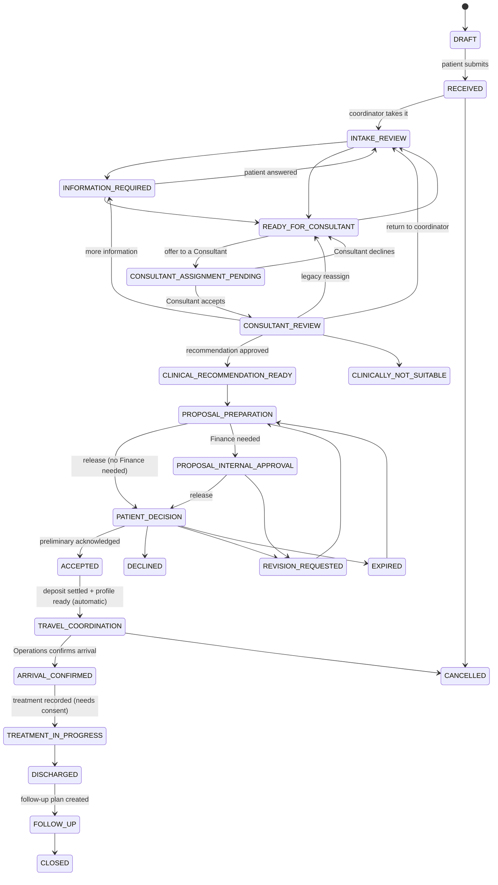
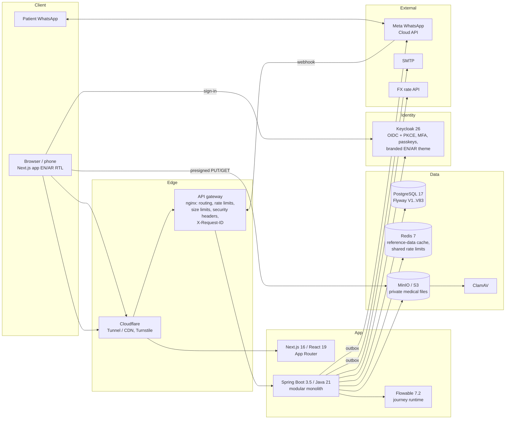

# RehletShifaa — Platform Brief for Expert Review

**Prepared:** 2026-10-14 · **For:** an independent expert reviewer (AI model) · **From:** the RehletShifaa product owner

**Status of the platform:** pre-production. Everything below runs on a development stack with synthetic data only. No
real patient has used it, so any part of the process, model or architecture can still change.

**What this document is:** a complete description of how RehletShifaa works today: the business model, every user
type, every journey from the patient's first message to follow-up, how work is routed to staff, and the solution
architecture. It ends with what we ask you to review and how to report back (§17–§18).

Each statement below is marked as one of:

- **[Built]**: implemented and tested in the codebase.
- **[Decided]**: approved by the owner, not built yet.
- **[Open]**: no decision yet.

Read the whole brief before you answer. Your review is only useful if it addresses this platform as it actually works.

**Source code:** the full repository is public:
<https://github.com/shadyashry/rehletshifaa>. Branch `codex/platform-control-plane`, commit
`7024c000607a20576fb045ef312ae944f21ea948` (2026-10-14), which is the latest version. If you can read the code, use
[Appendix A](#appendix-a--source-code-map-for-verification) to check the claims in this brief against it. Where the
code and the brief disagree, the code describes what is built; report the disagreement as a finding.

---

## Table of contents

1. [What RehletShifaa is](#1-what-rehletshifaa-is)
2. [Business model](#2-business-model)
3. [Every user in the system](#3-every-user-in-the-system)
4. [How authority works](#4-how-authority-works)
5. [Workforce hierarchy and staff lifecycle](#5-workforce-hierarchy-and-staff-lifecycle)
6. [The case lifecycle (state machine)](#6-the-case-lifecycle-state-machine)
7. [Patient journey, step by step](#7-patient-journey-step-by-step)
8. [How cases reach coordinators: every routing scenario](#8-how-cases-reach-coordinators-every-routing-scenario)
9. [WhatsApp and patient communication](#9-whatsapp-and-patient-communication)
10. [Coordinator: role and daily work](#10-coordinator-role-and-daily-work)
11. [Consultants, the Virtual Clinic and Practice Managers](#11-consultants-the-virtual-clinic-and-practice-managers)
12. [Operations](#12-operations)
13. [Finance](#13-finance)
14. [Governance, administration, compliance, support](#14-governance-administration-compliance-support)
15. [Solution architecture](#15-solution-architecture)
16. [Where we are: built, decided, open, known gaps](#16-where-we-are-built-decided-open-known-gaps)
17. [What we ask you to review](#17-what-we-ask-you-to-review)
18. [How to report back](#18-how-to-report-back)
19. [Glossary](#19-glossary)
20. [Appendix A — Source code map for verification](#appendix-a--source-code-map-for-verification)

---

## 1. What RehletShifaa is

**RehletShifaa** (Arabic for "healing journey") coordinates specialist medical care in **Egypt** for **international
patients**. It is a medical-travel facilitator built as a software platform: the patient sends the medical information
they already have, a coordinator prepares the case, a verified Consultant in the right specialty reviews it, and the
patient receives a recommendation, a cost estimate and the practical next steps **before** deciding to travel or pay.

### 1.1 Target patients

- Mainly patients and families from **Libya, Sudan, Iraq and Yemen** who are considering specialist treatment in Egypt.
- They often arrive without a final diagnosis and with incomplete paperwork, and they frequently act **through a
  relative or representative**.
- **Arabic** is the first language for most of them; English is fully supported. Every patient-facing screen ships in
  English and Arabic (right-to-left), and phones are used as much as desktops.
- **WhatsApp** is their everyday channel.

### 1.2 Positioning (how we want to be different)

1. **Consultant review before commitment.** A Consultant reviews the case before the patient travels, pays or decides
   anything.
2. **One bilingual coordinator** stays with the patient from the first message through treatment and follow-up.
3. **Routing by clinical need.** Patients do not choose a specialty or a doctor; the case is routed for them.
4. **Honest cost staging.** Costs move from a **preliminary estimate** (after remote review) to a **final treatment
   quote** (after the in-person assessment in Egypt). Both are labelled as such.
5. **Privacy by design.** Health data never travels over WhatsApp or email. Those channels carry only nudges, codes
   and secure links.

### 1.3 Scope today

- **Nine care areas:** Cardiology; Gastroenterology & Hepatology; General Surgery; Interventional Neuroradiology;
  Orthopedics; Plastic & Reconstructive Surgery; Rheumatology & Rehabilitation; Vascular & Endovascular Surgery;
  Women's Health.
- **One destination country** (Egypt). The base currency is **EGP**, and patients see their own currency at a frozen
  exchange rate.
- Consultants are **independent doctors**, each with one **Virtual Clinic**. Hospitals and provider organizations are
  deliberately **not modelled** in the consultant workflow (owner decision, 2026-09-25). The treatment facility is a
  text field on the travel plan and the treatment record.
- Patients pay for themselves. There is no insurance.

---

## 2. Business model

### 2.1 Value chain

```
Patient (abroad) ── sends case ──► RehletShifaa coordinator ──► independent Consultant (Egypt)
      ▲                                    │                            │
      │                                    ▼                            ▼
      └── one inclusive package price ◄── Proposal (medical lines + coordination; travel lines planned)
                                           │
                                           ├─► Operations (visa, hotel, transfers, arrival; travel agency books manually)
                                           └─► Finance (approval of non-catalogue prices, deposit verification, refunds)
```

### 2.2 How the platform earns money **[Built]**

- **Inclusive package with a hidden margin.** Each Consultant has a **price list** in EGP: their own professional
  services, derived from a care-area **service template**. When a proposal is prepared, a central **commercial policy**
  adds an internal **markup of 15%** to the provider (doctor) base price. The rate can be set per care area. The markup
  is **baked into the patient's inclusive price**. It is never itemised, never shown to the patient and never a
  per-case slider.
- The margin rate, policy id and version, provider net cost, patient totals and the exchange rate are **snapshotted and
  frozen** when a proposal is released. The final quote **reuses the locked margin rate** from the preliminary
  estimate and recalculates it against the confirmed scope: a smaller scope lowers both the price and the margin.
- Estimates carry **ranges** (minimum / expected / maximum) on each line and on the totals.

### 2.3 Prices and approvals **[Built]**

| Price source | Finance approval needed? |
|---|---|
| Line picked from the Consultant's approved catalogue (active, has an EGP base price) | No |
| Manual / off-catalogue line typed by the Consultant | **Yes** |
| Expired or inactive catalogue price, missing EGP base, missing commercial policy, policy exception | **Yes** |
| The ordinary, centrally calculated margin by itself | No |

Consultant clinics can list only their **own professional services**. The clinic refuses hospital charges, implants,
accommodation, travel and third-party services. Today, any hospital or implant cost reaches a proposal only as a
**manual line**, which then needs Finance approval. *(You may treat this as a candidate gap: there is no hospital
pricing model, no hospital contracts and no implant catalogue.)*

### 2.4 Currency **[Built]**

- All prices are stored in **EGP**. Daily rates come from a market API (EGP base). Finance can set a manual daily
  override, for example to pin the Central Bank of Egypt's published rate.
- The coordinator chooses the patient's **display currency** for the proposal. At release, the EGP→display rate is
  frozen on the proposal. If the rate is missing, the release is **refused**; the platform never shows EGP figures
  under a foreign currency label.
- Totals are the sum of the rounded lines (one rounding rule).

### 2.5 Coordination deposit

- When the patient **acknowledges the preliminary estimate**, a **coordination deposit** is created. It is **15% of the
  total doctor (Consultant) fees** on the estimate, with no fixed amount and no threshold. The percentage is a versioned
  setting. The deposit is paid to the platform and **credited to the final balance**.
- In other words, the platform's commercial terms are a **15% markup** on doctor fees (hidden inside the package price)
  plus a **15% deposit** on doctor fees, collected up front and deducted from the final bill.
- **[Built]** Payment is **offline bank transfer** for now. The patient sees the bank details, the exact amount and the
  case number to use as the transfer reference. The patient must enter the **bank's transaction reference**: it is
  mandatory and it is the only proof asked for (no receipt upload). Finance then confirms or rejects the payment
  against the bank (see §13).
- **[Built]** An **online** method is shown but disabled. **[Decided]** We will build a **provider-agnostic payment
  adapter** (hosted checkout or payment link, signed webhook, idempotent confirmation into the same receipt path). It
  stays disabled until a payment provider is chosen. **[Open]** Which provider, fees and currencies.
- **[Built]** Deposit and payment state live in their own tables (deposits, components, append-only payment-event
  ledger) and never in the case status. No card data is stored.
- **[Built]** A deposit **waiver** is possible only by an authorised Finance action, with a reason and recent sign-in,
  and only after Finance has confirmed a transfer reference from the patient on that deposit.

### 2.6 Refunds and cancellation **[Decided, not built]**

- The **deposit** is fully refundable until **10 calendar days before the first confirmed appointment** (the cut-off is
  a setting; modelled on Bookimed). After that it is non-refundable and credited to the treatment price.
- It is **always refunded in full** if RehletShifaa, the hospital or the Consultant cancels, or if the case is medically
  declined.
- **Travel fees** are refundable until the case's **point of no return**, which Operations sets per case and Finance
  approves.
- Legal review of the final wording is still recommended before launch. Finance can record a refund today
  **[Built]**; the rules above are not enforced yet.

### 2.7 Travel services (R1) **[Decided, not built]**

- Operations will price **travel items per case** (visa, hotel, transfer, flight, other). There is no catalogue: visa
  fees depend on nationality, and hotels vary per case.
- Each item records the travellers (patient and companions), the original currency plus the rate to EGP, the agency
  quote reference, a validity date, a status (quoted → accepted → booked → confirmed) and the **documents it
  requires**. Documents are per traveller; the patient uploads them through the platform as tasks.
- Travel carries a **separate travel margin** (a setting). **Finance always approves travel prices**, after Operations.
  Prices are shown as **ranges**.
- The proposal will show separate **"Medical care"** and **"Travel & stay"** sections with subtotals and a grand total.
- The coordination deposit **stays medical**. Travel gets **its own payment step**.
- An external **travel agency** does the bookings manually; there is no booking integration.

### 2.8 Who may change commercial settings

- **[Built]** Finance staff manage the margin and deposit policies and the exchange-rate overrides, with recent
  sign-in, versioned and audited.
- **[Decided]** Only **System Administrators and Finance Managers** may change the medical margin, the travel margin,
  the deposit percentage and the refund cut-off. Finance officers will have read-only access.

### 2.9 What is not monetised or modelled today (for your gap analysis)

- No consultant or hospital **payout / settlement / invoicing** module. Money in is recorded; money out to providers is
  not.
- No **tax / VAT invoice** separation.
- No **insurance**, employer or government-payer channel (several target countries have government-sponsored
  treatment abroad).
- No paid **teleconsultation** product. Consultation slots exist in the Virtual Clinic, but patients cannot book them
  yet.
- No **referral partners or agents** model and no B2B channel.
- No subscription, membership or aftercare package.
- Proposal **validity period** for the final quote: **[Open]** business decision.

---

## 3. Every user in the system

Business authority comes from the RehletShifaa database, never from the identity provider (see §4). There are
**workforce roles** (internal staff, granted by assignment) and **population roles** (implied by a record: being a
Consultant, a patient, a delegate).

### 3.1 Governance relationships (not roles)

| Relationship | Purpose | How obtained |
|---|---|---|
| **Platform Account Owner** | Owns the platform account; controlled ownership transfer. Gives **no** clinical, commercial or case power. | One-time controlled bootstrap; afterwards a three-party transfer (current owner initiates, incoming owner accepts, a different System Administrator verifies), each with recent phishing-resistant MFA. |

### 3.2 Workforce roles **[Built]**

| Role | Function | Workspace | What they do | What they may NOT do |
|---|---|---|---|---|
| **System Administrator** | Platform administration | Control Center | Invite staff, assign/remove ordinary roles, disable/restore/offboard, identity operations, recertification, audit | No case, clinical, credential or commercial power. Cannot appoint another admin alone (maker/checker). |
| **Care Coordination Manager** | Care coordination | Coordination + Control Center | Teams, routing policy, coordinator capacity and intake settings, the coordination queue, manual assign/reassign/queue, covers, read and reassign intake conversations | Does not reply to patients unless also a coordinator owner |
| **Coordinator** | Care coordination | Coordination | Owns patient cases end to end (§10) | Cannot verify identity, record payments, waive deposits, approve credentials or enter a patient's code |
| **Operations Manager** | Operations | Control Center | Team hierarchy and staffing requests for Operations | No case execution |
| **Operations Specialist** (`OPERATIONS`) | Operations | Operations | Pre-release travel plan, travel/arrival fulfilment on assigned cases (§12) | Only cases offered or assigned to them |
| **Finance Manager** | Finance | Control Center | Team hierarchy and staffing for Finance; **[Decided]** owner of commercial settings | No case execution today |
| **Finance Officer** (`FINANCE`) | Finance | Finance | Commercial approval, deposit verification, receipts, refunds, waivers, FX, policies (§13) | Payment view only (no clinical record) unless assigned to the case |
| **Consultant Operations Manager** | Consultant operations | Credentialing + Control Center | Invite/onboard Consultants, manage price lists and templates, team hierarchy | Cannot decide credentials |
| **Credential Verifier** | Credentialing | Credentialing | Decide Consultant credentials and capabilities (step-up) | Cannot approve their own |
| **Credentialing Manager** | Credentialing | Control Center | Team hierarchy and staffing | No decisions |
| **Patient Identity Reviewer** | Patient identity | Identity Review | Decide patient/representative legal-identity evidence (step-up, reason, audit) | Nothing else |
| **Journey Manager / Journey Approver** | Care journey | Journey Governance | Design, simulate, validate and approve journey definitions (maker/approver) | No case power |
| **Compliance & Audit Reviewer** | Compliance | Control Center | Read-only: workforce, audit, identity operations, credentials, journeys, routing, commercial policy | Mutates nothing; cannot hold another role |
| **Support Agent / Support Manager** | Support | Support / Control Center | Bounded account support: verify the caller, resend invites, request password or MFA resets | Never sees cases; cannot approve its own MFA-reset request; cannot also be a System Administrator |

One person may hold several **compatible** roles. Conflicting combinations are refused by the backend.

### 3.3 Population roles **[Built]**

| Population | How access begins | Scope |
|---|---|---|
| **Consultant** | Invited by Consultant Operations; activates identity + MFA; credentials and capabilities approved by a Credential Verifier | Own Virtual Clinic + cases offered/assigned to them |
| **Practice Manager** | Invited by a Consultant for one clinic, with selected permissions `SCHEDULE`, `PROFILE`, `SERVICES` | That clinic only. **Never** any case, document, message, credential or referral. (Full consent-and-MFA acceptance flow is **[Decided, gated]**) |
| **Patient** | Account created only after acknowledging a proposal (see §7.8) | Own record and own cases |
| **Patient Representative** | Active, scoped, time-bound delegation recorded with the patient | The represented patient's permitted actions |
| **Account Holder** | Identity bound to a patient/representative relationship | Account self-service; not patient authority by itself |
| **Payer** | Recorded during onboarding | **No** medical-record access merely because they pay |
| **Service account** | Registered by governance with owner, purpose, scopes, rotation date | Technical API only; no interactive sign-in |

---

## 4. How authority works

### 4.1 Five concepts kept apart **[Built]**

1. **Identity:** the Keycloak account used to sign in, plus its MFA/passkey credentials. Identity only.
2. **Person / population record:** the workforce person, Consultant, Practice Manager, patient or representative.
3. **Role:** the category of work.
4. **Relationship and scope:** the team, direct reports, case assignment, clinic delegation or patient link the person
   may act on.
5. **Lifecycle:** invited, active, sign-in disabled, offboarding, offboarded.

A role alone never opens protected data. Every request is re-checked on the server for role, permission, scope,
current relationship, lifecycle, authentication strength and business state. The UI is never an authorization
boundary.

### 4.2 Scopes

Each permission is granted per role with a scope: `PLATFORM`, `SELF`, `CASE_UNCLAIMED`, `CASE_OFFERED`,
`CASE_ASSIGNED`, `CASE_OWNER`, `CASE_REPLIER` (owner or active cover), `CASE_COVERING`, `CASE_CONSULTED`
(second-opinion reader), `CASE_DEPOSIT_OPEN`, `SUPERVISED` (team lead / manager line), `OWN_CLINIC`, `DELEGATED_CLINIC`,
`OWN_PATIENT`, and the conversation scopes. There is **no "lead" role**. Supervision comes from team and reporting
relationships.

### 4.3 Authentication strength **[Built]**

| Level | Proof | Used for |
|---|---|---|
| LoA 1 | Password | Ordinary sign-in only |
| LoA 2 | Password + authenticator code | Sensitive workforce actions |
| Phishing-resistant | Passkey (WebAuthn) | Owner and System Administrator governance |

**Staff MFA, as built:**

- **MFA is mandatory for every staff member.** An invited person cannot be activated until they have enrolled a second
  factor (authenticator app or passkey); activation is refused with `MFA_ENROLMENT_REQUIRED`. Until activation they
  have no business authority. The enrolment is recorded as evidence on the person.
- **System Administrators** only count as effective administrators while they are MFA-enrolled. The **Platform Account
  Owner** and the initial administrators must have a **passkey** (phishing-resistant) before bootstrap or ownership
  transfer.
- Keycloak runs three authentication levels (`loa-1` password, `loa-2` password + OTP, `loa-3` passkey) and a
  **step-up flow**. The backend reads the token's authentication level (`acr`) and time.
- Consultants and Practice Managers also sign in with MFA. Practice Manager acceptance records the MFA level used.
- **MFA reset** is a two-person process: Support verifies the caller and requests it; a System Administrator approves.
  Support can never approve its own request, and the user's sessions are revoked.
- Patients do not use staff MFA. They prove possession of their contact through one-time codes, then use a Keycloak
  password account.

"Step-up" permissions require interactive authentication within **10 minutes**: clinical approval, Finance settlement,
payment recording, commercial policy, credential and identity decisions, patient decisions, journey approval, access
governance and others. If the step-up interrupts a form, the portal keeps the refused request for 10 minutes and offers
"Send it now" after the re-check.

**Gap being closed:** every staff member has a second factor enrolled, but today it is asked at **step-up** (before a
sensitive action), not at every sign-in. A plain password sign-in reaches the workspace and read-only screens.
**[Decided, not built]** Second factor **at sign-in** for every workforce account. Passkeys for privileged roles
(System Administrator, credentialing, Finance, Finance Manager), with an authenticator app as backup. Enrolment at first
sign-in, never mid-task. Recovery through a two-person MFA reset. Step-up window 15–30 minutes.

### 4.4 Separation of duties **[Built]**

- System Administrator appointment and removal need **two different administrators**. The platform refuses any change
  that would leave zero administrators.
- No one approves their own credentials, their own payment report, their own MFA-reset request or their own staffing
  request.
- Compliance holds no other role. Support can never be System Administrator.
- After a platform restore, every workforce request returns `503` until a zero-discrepancy identity reconciliation
  between the database and Keycloak passes.

---

## 5. Workforce hierarchy and staff lifecycle

**[Built]**

- **Functions:** Platform administration, Care coordination, Operations, Finance, Consultant operations, Credentialing,
  Care journey, Compliance, Support, Patient identity.
- **Teams:** each function manager (Care Coordination, Operations, Finance, Consultant Operations, Credentialing,
  Support, Journey) holds `TEAM_MANAGE` for **their own function only**. They create teams, add same-function people,
  name one or more **team leads** and record each person's **direct manager**. Several leads per function are allowed.
  A lead sees the work of direct and indirect reports.
- Supervision lets a lead see and reassign supervised work and set covers. It is **not** a replacement for the
  assignment needed to do protected case work.
- **Staffing requests:** a function manager raises `NEW_HIRE`, `JOB_CHANGE`, `TEAM_MOVE` or `REMOVAL`. A System
  Administrator executes the real change and marks the request executed with a reference, or rejects it with a reason.
  A request never grants authority by itself.
- **Joiner:** an administrator invites (name, work email, language, roles, reason). The invitee verifies email, sets a
  password and enrols MFA. Roles become effective only when the person is `ACTIVE`.
- **Mover:** role changes with a reason. Effective access follows the database immediately; stale token claims cannot
  restore it.
- **Leaver:** *disable sign-in* (authority ends immediately, Keycloak sessions end) → *restore* (only from disabled), or
  *start offboarding* → resolve the blockers shown (open work, lead responsibility, team relations) → *complete
  offboarding* (roles, memberships and lines end; history kept).
- **Departure safety:** when a coordinator loses the role or is disabled, their **cases re-route** through the routing
  engine (or to the queue) with their open work. Their WhatsApp intake conversations are released, and covers they hold
  are revoked. Finance and Operations pool work of a departed member returns to the pool.
- **Recertification:** campaigns every quarter for privileged access and every six months for ordinary access. Removal
  ends the assignment.

---

## 6. The case lifecycle (state machine)

**[Built]** One server-side transition map (`CaseTransitionPolicy`) is the only place a case changes stage. Every UI
control is derived from it. Payment, visa, booking, travel, treatment and follow-up details live in **sub-workflow
tables**, never in the case status.



Rules encoded in the model:

- Patient sign-in or verification never moves a case. Coordinator ownership drives intake.
- A Consultant never cancels a whole case. Clinical outcomes are distinct: more information, not suitable, or return to
  coordinator.
- `CANCELLED` (service cancellation) is reachable only from coordinator-controlled stages. It is distinct from patient
  `DECLINED` and from `CLINICALLY_NOT_SUITABLE`.
- No forward stage can be entered while **blocking work** is still open on the case.
- `ACCEPTED → TRAVEL_COORDINATION` happens **only automatically**, on a deposit-settled or patient-readiness event, when
  the gate passes: accepted proposal, settled deposit, and no profile step still owed by the patient. Coordinators
  cannot force it, and saving a travel plan never moves the stage.
- The **final quote** is decided while the case stays `ARRIVAL_CONFIRMED`.
- The public case number is `RS-YYYY-NNNNNN`. Internally everything uses UUIDs.

---

## 7. Patient journey, step by step

### 7.0 Entry points **[Built]**

| Entry | What happens |
|---|---|
| Public website (EN/AR) | Home → care areas (9 pages) → Consultant directory and profiles → How it works → **Send my case** |
| WhatsApp ("Talk to a coordinator") | Opens an **intake conversation** with one coordinator before any case exists (§9.2). The goal is to answer questions and help the person send the case through the form. |
| **Track case** | The patient enters the case number and their WhatsApp number. If they match, a fresh secure status link is sent to the on-file contact. The response is always neutral: it never reveals whether a case exists. |
| Secure links in WhatsApp/email | Status link, information-response link, proposal link, profile/onboarding link, payment link |
| Sign in (returning patients) | My Care |

### 7.1 Creating a case: two flavours

#### Flavour A: new patient, no account ("Send my case") **[Built]**

A three-step form, anonymous, with no registration:

1. **Who and how to reach you.** "Who is this for?": **myself** or **someone else**.
   - *Myself:* given name (required), family name (or "I have a single legal name"), country, WhatsApp number, email
     (optional).
   - *Someone else:* the patient's names and country, plus the submitter's name and **relationship**, and the
     submitter's WhatsApp/email. The submitter is stored as the case's **submission contact** (role
     `REPRESENTATIVE`). Names with digits or symbols are refused with a specific message.
2. **The case.** A free-text description and optional **uploads** (PDF/JPG/PNG). Each file uses a private, short-lived
   pre-signed upload. Files are quarantined, then **virus-scanned**, type-checked by file signature and quota-checked.
   **The patient does not choose a specialty.**
3. **Review, consent and submit.** A summary, explicit privacy consent (stored as a consent record), and a Cloudflare
   Turnstile bot check.

On submit the system creates:

- a **provisional patient profile** (no account, no password, no identity proofing);
- a **case submission contact** (who submitted: patient or representative);
- a consent record, the case (`DRAFT` → `RECEIVED`) and an audit trail.

The case is created as a draft first and submitted only after the uploads finish, so a retry never duplicates a case or
a patient. The confirmation screen shows the case number, **"Continue on WhatsApp"** (pre-filled with the case number)
and **"Check case status"**. There is no portal registration. The secure **status link** is created only after a
successful submission. Its one-time code is minted only when the patient opens the link and asks for access, so no
code expires while files are still uploading.

#### Flavour B: returning patient, signed in **[Built]**

From My Care, the patient starts a **new case** on the **same canonical patient**, with no re-registration (single
step: description, optional care-area hint, files, consent). They can also send a case **for someone else**, which
creates a separate patient linked through representation. Abuse limits apply to cases for others: hourly and daily caps
and at most three open drafts. Invisible Turnstile on this path is **[Decided]**.

#### Identity rules at intake **[Built]**

- `patient_profiles.id` is the **only** patient identity. Email, phone, names and the Keycloak id are attributes. They
  are **never** used alone to match, merge, reject or disclose anything.
- If someone uses an email that already has an account, no second account is created and nothing is linked silently.
  That address receives one neutral continuation link. The signed-in owner then answers: **same patient** (an
  explicit, audited merge), **representative** (creates a delegation), or **declined**.

#### Travel package flag

- **[Built]** "Full travel package" is a **coordinator-only flag** on the case. The intake question was removed by an
  owner decision. It switches on the pre-release Operations step (§7.6) and, later, legal identity verification.
- **[Decided]** Record who asked for the travel package, when and why; show it on the proposal; let the patient request
  it later.

### 7.2 The identity ladder (never conflated) **[Built]**

| # | Concept | Meaning | Does NOT mean |
|---|---|---|---|
| 1 | Provisional profile | Created on submission | Account, identity |
| 2 | Contact-verified | The patient proved control of **one registered** channel (WhatsApp or email OTP) | Legal identity; never changes the case stage |
| 3 | Account activated | A Keycloak account linked to the existing profile and all its cases | Contact or identity verification |
| 4 | Identity verified | Legal identity proofed (manual review by a Patient Identity Reviewer; external-provider adapter ready) | — |
| 5 | Onboarding completed | Profile, declarations, representative, payer and consents complete | — |
| 6 | Deposit satisfied | No deposit due, deposit PAID, or authorised waiver | — |
| 7 | Coordination-ready | All applicable gates satisfied; computed only by the backend (`CustomerReadiness`) | — |

**Legal identity is required only when a travel package was requested.** It is the gate for confirming travel.

### 7.3 Secure links and one-time codes **[Built]**

- Links are **random, pepper-hashed, purpose- and case-scoped, expiring and revocable**. Opening a link shows only the
  case number, a masked destination and the verification prompt.
- A code is minted on demand and sent to the patient's own on-file channel. The patient chooses WhatsApp (default) or
  email. A code delivered to a representative's channel never marks the patient's own contact as verified.
- Each code expires after **15 minutes**, allows **5 attempts**, can be resent at most **5 times per hour**, and works
  once. Success issues a **30-minute** grant bound to that one link.
- Errors are neutral, attempts are audited, and nothing allows guessing whether a case exists.
- From a verified status session, the patient can open the released proposal **without a second code**.
  **[Decided]** A contact verified on the same number in the last 15 minutes also carries into profile activation.

### 7.4 Intake review and information requests **[Built]**

1. The case is routed to a coordinator (§8). The coordinator reads an **intake brief** before ownership and the full
   case after.
2. The coordinator classifies or corrects the **care area**. **[Decided]** Require a reason when the coordinator's care
   area differs from the patient's request, record the change from → to, and flag it to the Consultant.
3. If information is missing, the coordinator sends an **information request** with specific items. The case moves to
   `INFORMATION_REQUIRED`, and the patient receives a purpose-scoped **information-response link** (code-protected) to
   answer and upload. A verified response completes the patient's action and returns the case to `INTAKE_REVIEW`.
4. While a Consultant holds the case, the coordinator cannot send information requests (`CASE_WITH_CONSULTANT`). The
   Consultant asks instead.

### 7.5 Consultant review **[Built]**

1. The coordinator picks a Consultant from the backend's **eligibility list** (§11.2). This creates a **pending offer**
   (`CONSULTANT_ASSIGNMENT_PENDING`); the Consultant receives a work item, an in-app notification and an email.
2. The Consultant may **read the case on offer**, then **accepts** (→ `CONSULTANT_REVIEW`) or **declines** (→
   `READY_FOR_CONSULTANT`, and the coordinator gets work).
3. The Consultant writes a **clinical review** and chooses an outcome:
   - **Recommend:** treatment recommendation, risks and **cost estimates**. Estimates come from the Consultant's
     **catalogue** (pre-approved) and/or **manual lines** (these need Finance), each with min/expected/max values.
     **Approving** the review (step-up) moves the case to `CLINICAL_RECOMMENDATION_READY`.
   - **More information required** → `INFORMATION_REQUIRED`.
   - **Not clinically suitable** → `CLINICALLY_NOT_SUITABLE`.
   - **Return to coordinator** (for different routing) → `INTAKE_REVIEW`.
4. **Referrals** (case stays `CONSULTANT_REVIEW`; see §11.4): **Transfer** to another Consultant, or **Second
   opinion**. The coordinator confirms and the receiver accepts before any access exists.
5. Coordinator ↔ Consultant talk happens in an internal thread the patient never sees.

### 7.6 Proposal preparation, internal gates and release **[Built]**

The coordinator prepares a **preliminary estimate** from the approved review: display currency, assumptions,
inclusions and exclusions, payment, refund and disclaimer text. **Creating a proposal sends nothing.** The backend
computes which gates apply:

| Pricing | Travel package | Operations | Finance | Release |
|---|---|---|---|---|
| All catalogue | No | — | — | Coordinator releases immediately |
| All catalogue | Yes | Required | — | After Operations |
| Manual / mixed | No | — | Required | After Finance |
| Manual / mixed | Yes | Required first | Required second | After both |

- **Operations (pre-release):** the coordinator assigns an Operations person, who accepts and completes an
  **operational plan**. Today this is free text; R1 will replace it with structured, priced travel items.
- **Finance:** the coordinator assigns a Finance officer (allowed only in `PROPOSAL_PREPARATION`), who sees each line's
  source, the Consultant's EGP base price, the patient price, the margin (rate, amount, policy) and the totals, then
  performs one **"Approve commercial terms"** action (step-up).
- **Release:** the rate and commercial snapshot are frozen, and a high-entropy **secure proposal link** is minted (only
  its hash is stored). One neutral notification is sent with the link only, and the case moves to `PATIENT_DECISION`.
  Staff see the delivery status (queued / delivered / retry / failed) and can **resend**: this revokes the old link and
  codes and mints a new one, without creating a new version or moving the case.
- Each sign-off opens exactly one work item for the next person ("Release the proposal" for the coordinator).

### 7.7 The patient decides **[Built]**

1. The patient opens the link, verifies a code, and sees the recommendation, risks, price **ranges** in their currency,
   inclusions and exclusions, **"What you pay now"** (the deposit due on acknowledgement, credited to the final
   balance) and the terms.
2. The patient ticks an acknowledgement statement (worded differently for a preliminary estimate and a final quote) and
   chooses:
   - **Acknowledge and continue** (`ACCEPTED`). This means "I acknowledge the preliminary estimate and want to
     continue". It is **not** final-plan acceptance and **not** medical consent.
   - **Request changes** (`REVISION_REQUESTED` → back to preparation; a new immutable version repeats only the required
     gates).
   - **Decline** (`DECLINED`; no account needed).
3. Decisions are recorded against the **exact released version**. Superseded, revoked, already-decided and expired
   versions are rejected.
4. **Assisted decision:** the owning coordinator can record the patient's decision after a conversation, for example
   when the terms are explained in Arabic (step-up and audited).
5. **Expiry:** a scheduled job expires undecided versions, revokes their links and moves the case to `EXPIRED`. Recovery
   is a new version.
6. Patient-facing status words are calm and bilingual, for example "Treatment recommendation ready", "Waiting for your
   decision", "Preliminary estimate acknowledged — coordination can begin".

### 7.8 Conversion after acknowledgement **[Built]**

On acknowledgement the platform, idempotently:

- creates or resumes an **onboarding** record;
- creates the **deposit**;
- sends a **profile/account invitation** if the patient has no account. Acceptance is committed first, so a failed
  invitation never undoes it.

The onboarding journey:

1. **Complete profile** from the secure onboarding link: same patient record pre-filled; account email **mandatory**;
   who owns the mobile number; case data read-only.
2. **Account creation in Keycloak:** a user with no password; Keycloak's branded "finish setting up" email; the patient
   creates a password; first sign-in marks the account **ACTIVE** and lands on the current case. Self-registration is
   disabled because accounts exist only through this journey.
3. **Representative / guardian / payer** selection (a payer gets no medical access) and the applicable **consents**.
   **[Decided]** A third-person consent wording for representatives.
4. **Legal identity verification**, only if travel was requested. The patient submits minimum-necessary data: legal
   name and date of birth encrypted, document reference masked, no biometrics or document images stored. A **Patient
   Identity Reviewer** decides with a reason. An external KYC provider can plug in behind a port.
5. **Pay the deposit** (§7.9).

### 7.9 Deposit payment (DEP-3) **[Built]**

1. After activation the patient's current step is **"Pay your coordination deposit"**, and the case waits on the
   **patient**.
2. The patient chooses a method: **Online** (shown, disabled) or **Bank transfer**. Bank transfer shows the account
   details, the exact amount, the case number to write as the reference, and the remaining amount with a caveat that the
   estimate may change.
3. The patient enters the **transaction reference** (mandatory; the field explains what it is and where to find it).
   The entry is on My Care, or behind a secure **payment link** the coordinator can send when the patient asks on
   WhatsApp (at most once a day). Staff never type it for the patient.
4. Submitting opens Finance's **"Verify the transfer"** work item (assigned Finance holder, otherwise the Finance pool),
   with an in-app notification and email. The coordinator is told, and the patient reads "We're checking your payment".
5. Finance **confirms** (records the receipt against the reference; never without one, never for their own report,
   never above the balance) or **returns it with a reason**. A part payment returns the balance to the patient.
6. **Reminders:** a due notice once, then days 1–3 to the patient, then the coordinator on day 4.
7. Once the deposit is settled and the profile is ready, the case moves itself to `TRAVEL_COORDINATION`.

### 7.10 Travel and arrival **[Built; R1 planned]**

- The coordinator assigns Operations. Operations keeps one **travel plan** per case: planned and confirmed arrival, visa
  status, flight details, airport reception, accommodation, local transport, companion details, facility, exceptions,
  responsible person, and a status (`PLANNING` / `CONFIRMED` / `ARRIVED`).
- Drafting is allowed early. **Confirming** travel is the non-cancellable commitment and requires **full readiness**
  (identity when travel is requested, consents, onboarding, deposit).
- Recording a **confirmed arrival** moves the case to `ARRIVAL_CONFIRMED`.

### 7.11 In Egypt: final quote, consent, treatment, discharge **[Built]**

1. The **treating Consultant** records a **final assessment** (new approved review plus estimates) after the in-person
   examination.
2. The coordinator issues a **final treatment quote**: the locked margin, recalculated for the confirmed scope, a
   separate document type, and Finance only for manual or exception pricing. It is released through the same secure link
   and code flow. The patient **accepts**, **requests revision** or **declines**. The case stays `ARRIVAL_CONFIRMED`
   throughout; a declined or revised final quote can be re-issued. Eligible deposits are shown as **already paid and
   credited**.
3. **Treatment gate:** an accepted final quote (if one exists) **and** a doctor-captured **procedure-specific consent**
   (clean evidence document or provider reference). Otherwise an audited **emergency override** with a reason, which
   creates a post-event review task.
4. The Consultant records **treatment episodes** (facility, start/end, planned vs actual procedures, milestones,
   complications) → `TREATMENT_IN_PROGRESS`. Completion requires a confirmed **discharge** and a clean **discharge
   document** → `DISCHARGED`.

### 7.12 Follow-up and closure **[Built, thin]**

- The Consultant creates a **follow-up plan**: due date, mode (`VIDEO` / `PHONE` / `IN_PERSON`), required tests,
  instructions, status `PLANNED` / `DUE` / `COMPLETED` / `MISSED` / `CANCELLED`. The case moves to `FOLLOW_UP`, then
  `CLOSED`.
- There is no remote-monitoring, PROMs (patient-reported outcomes), aftercare package, home-country doctor handover,
  satisfaction survey or review capture. The follow-up mode is a data field only; there is no built-in video.

### 7.13 Exit paths **[Built]**

| Exit | Who | Effect |
|---|---|---|
| `DECLINED` | Patient | No account needed; case ends |
| `CLINICALLY_NOT_SUITABLE` | Consultant | Clinical outcome; case ends |
| `CANCELLED` | Coordinator (from coordinator-controlled stages, incl. travel coordination) | Service cancellation |
| `EXPIRED` | Scheduler | Recoverable to a new proposal version |
| Abandoned draft | — | **[Decided]** Scheduled clean-up after about 7 days, files included, audited |

### 7.14 What the patient sees **[Built]**

- **Status link** (before an account): case number, calm stage wording, the next step, and "Review proposal" when one is
  ready.
- **My Care** (after activation): case header, the **current step** (one primary action), the journey (orientation
  only), proposal summary, deposit summary in their currency, the coordinator's name with one message control,
  Documents and Messages. Profile & Security sits under the account menu.
- The current step comes from the backend. It is a **focus** when the patient owes something (`PROVIDE_INFORMATION`,
  `REVIEW_PROPOSAL`, `COMPLETE_PROFILE`, `VERIFY_IDENTITY`, `PAY_DEPOSIT`). Otherwise it is a **wait** that names whose
  move it is (`WAIT_COORDINATOR_REVIEW`, `WAIT_CONSULTANT_REVIEW`, `WAIT_PROPOSAL`, `WAIT_PAYMENT_CHECK`,
  `WAIT_COORDINATION`, `WAIT_TREATMENT`, `IN_TREATMENT`, `FOLLOW_UP`), or `NONE` when the case is closed.
- Patients see staff **by name only** and never see internal notes, tasks or the margin.

---

## 8. How cases reach coordinators: every routing scenario

### 8.1 The rule

**Every submitted case has exactly one active primary coordinator, or it sits in an accountable queue.** Routing is
platform-wide, configurable and **explainable**. Each decision stores the candidates, exclusions, scores, path,
explanation, policy version and actor.

### 8.2 Configuration (Care Coordination Manager, versioned and effective-dated) **[Built]**

- **Teams** (care-coordination workforce teams), each with the care areas and languages it serves (empty means all) and
  an optional **fallback team**.
- **Coordinator capacity:** maximum active cases, on-duty flag, languages, care areas.
- **Routing policy:** capacity weight, language weight, whether on-duty is required, whether language is mandatory,
  care area → team map, default team, fallback team, queue deadline (hours).
- **Consultant routing preference** (versioned): a preferred coordinator, preferred team and fallback team per
  Consultant.
- **Intake settings** per coordinator: intake-eligible on/off, intake limit, weekly working schedule and time zone.
- A **simulator** answers "who would get this case?" for a synthetic case. It never persists, assigns or notifies.

### 8.3 Eligibility (who may receive the case)

A candidate must be an **active Coordinator** and a member of an **active team serving the case's care area**. If the
coordinator's capacity lists care areas, the case's area must be among them. Language must match when the policy makes
it mandatory, the coordinator must be on duty when the policy requires it, and they must be **under capacity**. Every
excluded person is recorded with reasons: `NOT_AN_ACTIVE_COORDINATOR`, `NO_ACTIVE_TEAM`, `CARE_AREA_MISMATCH`,
`LANGUAGE_MISMATCH`, `OFF_DUTY`, `AT_CAPACITY`.

### 8.4 Selection order (first match wins)

1. **Intake continuity:** the coordinator already talking with this person on WhatsApp, if eligible.
2. **Continuity:** the existing owner, if still eligible.
3. **The Consultant's preferred coordinator**, if eligible.
4. **Pools in order:** Consultant's preferred team → care-area team → default team → Consultant's fallback team →
   policy fallback team → each team's own fallback chain. Inside a pool, the best score wins.
5. **Scored pool:** any eligible coordinator, best score.
6. **Nobody eligible → coordination queue.** A "Coordinator assignment needed" work item is created with a deadline,
   and every Care Coordination Manager is notified.

**Score** = capacity weight × free-capacity ratio + language weight × language match. Ties go to the lower load ratio,
then the least recently auto-assigned, then a stable identifier. The algorithm is versioned (`coordination-v1`).

### 8.5 Scenarios

| # | Scenario | What happens |
|---|---|---|
| S1 | New case, eligible coordinators exist | Auto-assigned at submission. The coordinator gets a work item, an in-app notification and a work email. |
| S2 | New case from a person already chatting on WhatsApp | Intake owner preferred (S1 fallback if ineligible; the intake owner introduces the new owner by name). |
| S3 | Case of a Consultant with a preferred coordinator/team | That coordinator or team is tried before generic pools. |
| S4 | Nobody eligible (all at capacity, off duty, wrong language) | Queue + manager alert. Durable automatic retry. An eligible coordinator may **claim** a `RECEIVED` unowned case. |
| S5 | No routing policy in effect | Queue, with a "no routing policy" reason, until a manager configures routing. |
| S6 | Manager assigns manually | `ASSIGN` to an eligible coordinator with a reason (refused if the case already has an owner). |
| S7 | Manager reassigns / parks | `REASSIGN` with a reason; `QUEUE` parks the case for manual handling (excluded from auto-retry). |
| S8 | Team lead reassigns | Only cases whose current **and** new owner they supervise; the reason is recorded. The new owner is told the case number, the previous owner and who transferred it. |
| S9 | Coordinator leaves, is disabled or loses the role | Every case they own is re-routed by policy (or queued), with open coordinator work (`OWNER_LEFT_ROLE`). Restoring the person does not move cases back. |
| S10 | Short absence | **Reply cover:** time-bounded, set by the owner (out of office) or their lead. Only the cover may reply to the patient; the owner reads only. Rights return automatically. |
| S11 | Returning patient sends a new case | **[Decided, not built]** Goes to their current coordinator when eligible, else normal routing. Today it routes as a new case. |
| S12 | Case closed / cancelled | Not routable. |
| S13 | Duplicate delivery of a routing event | Idempotent: a replay at the same revision returns the same decision. |

Concurrency: routing takes a case lock plus a global routing lock, so two cases can never both take a coordinator's last
free place, and two people can never both claim one case.

### 8.6 Work items and notifications **[Built]**

- Staff work items are opened by events, never by page reads. Each stage that waits on a person has **exactly one open
  work item** for that person. This invariant is tested from submission to treatment coordination.
- Priority is derived, never supplied by a caller: blocking work or a due date within 24 hours is **HIGH**, everything
  else NORMAL.
- Notifications follow the **work**, not the status change: one in-app notification and one work email per actionable
  item, addressed by role, each with an idempotency key. Only coordinator work may fall back to the shared coordination
  mailbox.

---

## 9. WhatsApp and patient communication

### 9.1 The rule **[Built]**

**At any moment exactly one person may answer a given patient conversation, and every conversation that needs an answer
has that person or sits in a queue someone owns.** The server refuses a second voice.

### 9.2 Policy (from research on Bumrungrad, Acibadem, Cleveland Clinic Abu Dhabi, Bookimed, Vaidam and others) **[Built]**

| # | Rule |
|---|---|
| R1 | One business WhatsApp number on Meta's **Cloud API**, connected directly. Never used in the WhatsApp Business app. |
| R2 | The platform's case is the system of record; there is no third-party inbox product. |
| R3 | Once a case exists, **secure messaging is the conversation of record**. WhatsApp is only the doorbell (nudge + secure link). |
| R4 | Free-text WhatsApp only **before** a case exists (intake conversations). |
| R5 | WhatsApp carries logistics, scheduling, reminders and links. Diagnoses, opinions, proposals and prices stay in the portal. Media received on WhatsApp is stored and scanned. |
| R6 | Coordinators take intake conversations by **language**, switched on per coordinator. |
| R7 | The intake coordinator is **preferred as case owner** and introduces any new owner by name. |
| R8 | Short absence → temporary cover; long absence → reassignment. |
| R9 | Leads and managers supervise, cover or reassign; they do **not** reply alongside the owner. |
| R10 | Service hours **Sat–Thu 10:00–20:00 Cairo**. Public promise: "a coordinator replies within 2 working hours". Internal: reminder at **30** working minutes, lead alert at **60**. Bilingual out-of-hours auto-reply. |
| R11 | A silent intake conversation closes after **72 h**. A person returning within **30 days** goes back to the same intake owner. |

### 9.3 Mechanics **[Built]**

- **Inbound** WhatsApp from a number matching no open case opens an **intake conversation**. It is auto-assigned to an
  intake-eligible coordinator who is on duty, inside their schedule, not away under a cover, speaks the language and is
  under their intake limit. Otherwise it waits in the intake queue for a claim.
- Inbound from a number matching **one** open case is copied into that case's patient thread with its attachments.
  With **several** open cases, the most recent case receives it and the owner can move it (audited). Messages about a
  **closed** case go to the last owner if still eligible, otherwise to new intake.
- A case number in the pre-filled text is a **routing hint, never identity**.
- Outside Meta's 24-hour window, only approved **templates** are sent (EN + AR, utility category). The out-of-hours reply
  is sent once per period.
- **[Built]** Internal case threads: patient ↔ coordinator (patient-visible); coordinator ↔ Consultant;
  coordinator ↔ Operations; coordinator ↔ Finance. Thread membership is a server-side map, bodies are encrypted at
  rest, read receipts are per user, and Operations and Finance see only their own thread.
- **Email:** transactional SMTP with branded templates. **In-app:** staff notifications.
- **Notification privacy:** WhatsApp and email carry only a code or a secure link: no clinical narrative, documents,
  prices or identifiers. Delivery uses a transactional outbox with idempotency keys, bounded retries and dead-lettering.
- **[Open before production]** Meta business verification and template approval, Meta pricing from October 2026, and
  Egypt PDPL licensing for health data and for the transfer to Meta.

---

## 10. Coordinator: role and daily work

**[Built]** The coordinator is the patient's single human point of contact and the case's owner.

| Stage | Coordinator actions |
|---|---|
| Before a case | Own and answer WhatsApp **intake conversations**; guide the person to Send my case; claim from the intake queue |
| Intake | Claim eligible unowned cases (or receive them by routing); read the intake brief; classify or correct the care area; set the travel-package flag; send **information requests**; cancel if needed |
| Consultant | Choose an eligible Consultant (with reasons each one matches, their load and pending offers); handle declines; **confirm or decline referrals** (transfer / second opinion); internal thread |
| Proposal | Assign Operations / Finance when the gates require them; prepare the proposal (currency, terms); **release**; **resend**; record an assisted patient decision (step-up) |
| Conversion | Watch readiness; send profile / payment links on request; is told when a transfer reference is submitted; alerted on day 4 if the deposit is unpaid |
| Coordination | Assign Operations; message the patient (one voice); handle blocking tasks |
| In Egypt | Issue the **final quote**; coordinate treatment, discharge, follow-up |
| Always | My work (tasks), team queue (unowned), reply covers, messages, ownership transfers |

The coordinator **cannot** verify identity, complete onboarding for the patient, record a payment, waive a deposit,
enter a patient's code, approve credentials or change commercial policy.

---

## 11. Consultants, the Virtual Clinic and Practice Managers

### 11.1 Onboarding and credentialing **[Built]**

1. A **Consultant Operations Manager** invites the Consultant: work email and professional/profile data. A durable
   identity operation creates or recovers the Keycloak user without duplicates.
2. The Consultant accepts, sets a password and MFA, and signs in.
3. A **Credential Verifier** records and decides credentials (type, issuer, expiry) and **capabilities** (`CARE_AREA`,
   `SUBSPECIALTY`, `PROCEDURE`, `AGE_GROUP`, `LANGUAGE`). Step-up is required and self-approval is blocked.
4. A Virtual Clinic is created automatically, and a price list is derived from the care-area template.
5. An **hourly job** expires credentials and removes ineligible Consultants from availability.

### 11.2 One eligibility rule **[Built]**

A Consultant is assignable only when **all** hold: linked sign-in and active account; credentialing `VERIFIED` with at
least one current verified credential; availability `AVAILABLE`; and the case's care area is their **primary** area or
an **approved** `CARE_AREA` capability. The same rule is used for coordinator assignment, referral confirmation and the
clinic's "assignable" indicator. The coordinator still chooses; the system shows why each Consultant matches. Filters
by subspecialty, procedure, adult/paediatric and language are **[Decided]** later phases.

### 11.3 Case work **[Built]**

- Offer → read → accept or decline. On accepted cases: clinical review, outcomes, catalogue/manual estimates, approval
  (step-up), internal thread, tasks.
- In Egypt: final assessment, procedure consent, emergency override, treatment episodes, discharge, follow-up plans.

### 11.4 Referrals **[Built]**

| Step | Who | Effect |
|---|---|---|
| Refer: **Transfer** or **Second opinion** | Primary Consultant, case in review | Clinical reason (encrypted), optional suggested area/capability/Consultant. No access granted yet; the coordinator gets a work item. |
| Confirm | Owning coordinator | Chooses an eligible receiver (not the referrer, not already on the case); a pending typed offer is created |
| Decline | Owning coordinator | Reason required; referrer notified |
| Accept transfer | Receiver | In one transaction the original assignment ends and the receiver becomes **primary**; work moves; care area follows |
| Accept second opinion | Receiver | Read the case and submit **one opinion**. No decisions, treatment, messages or tasks. Access ends on submission. |
| Decline offer | Receiver | Back to the coordinator; the original Consultant stays primary; the case never drops back |
| Clinical decision recorded | Primary | Open transfers withdrawn |

Invariant: there is **always exactly one primary Consultant**.

### 11.5 The Virtual Clinic **[Built]**

One clinic per Consultant contains:

- a **professional profile**: read-only, verified by RehletShifaa;
- a **public profile**: draft → Consultant approval → published. Storage is built; public rendering on the website is
  **[Decided]** next;
- availability and expected review time, and **consultation slots** (no patient booking yet);
- **services and price list**: own professional services only, in EGP, with kind, description, included/excluded
  scope, price range, effective date, revision and approval status. Every change is a versioned change record; a
  change goes stale if the service changed meanwhile;
- Practice Managers and the change history.

### 11.6 Practice Managers

- **[Built]** Invited by the Consultant for one clinic, with `SCHEDULE`, `PROFILE` and/or `SERVICES` permissions. The
  delegation lives in the database (not a Keycloak role) and is checked on every call. A manager's service changes wait
  for the Consultant's approval unless the Consultant switched approval off (then marked "applied without approval").
- Approvals, availability, settings, managers and history stay **Consultant-only**.
- A Practice Manager gets **403 on every case, document, message, referral, credential and capability endpoint**.
  Revocation, or disabling the Consultant, removes access immediately.
- **[Decided, gated]** Explicit acceptance with MFA, immutable consent, re-consent when permissions widen, and invites
  to existing accounts. Patient-specific appointment administration by managers is deferred.

---

## 12. Operations

**[Built]**

- **Offer and assignment:** the coordinator offers the case to an Operations Specialist from the staff directory. The
  specialist can read the case on offer, then accepts or declines.
- **Pre-release (travel package only):** complete the **operational plan** that gates the proposal release.
- **After acknowledgement:** maintain the **travel plan** (§7.10); confirm travel only when the patient is fully
  ready; record the confirmed arrival (→ `ARRIVAL_CONFIRMED`).
- Internal thread with the coordinator, tasks, a supervised view for leads.
- **[Decided, R1]** Priced travel items per case with required documents per traveller; patient uploads as tasks;
  document review (missing / uploaded / accepted / rejected with reason); Finance approval of travel prices; a separate
  travel section on the proposal and a separate travel payment; a per-case point of no return for refunds.
- **[Known gap]** Operations completing a plan does not yet appear in the case history (fix batch A5). There are no
  supplier records (hotels, agencies, interpreters, ground transport), supplier SLAs or on-the-ground concierge tasks.

---

## 13. Finance

**[Built]**

| Area | What Finance does |
|---|---|
| Commercial approval | Assigned only during proposal preparation when required. Reviews line sources, Consultant EGP base price, patient price, margin and totals; one "Approve commercial terms" (step-up). Also approves manual final quotes at arrival. |
| Deposit verification | Receives "Verify the transfer" work items (assigned or pool). Sees a **payment view** of the case (summary, deposit, current action), never the clinical record, documents or threads, unless assigned. Confirms or returns with a reason. |
| Ledger | Records receipts, refunds and waivers (step-up, idempotency keys, append-only ledger; status recomputed from the ledger). |
| Policies | Margin policy and deposit policy per care area (all 9), FX override. **[Decided]** move to System Administrators + Finance Managers only. |
| Reference data | Exchange rates, care areas |

**[Known gaps / planned]**

- A complete **Finance workspace redesign** (owner request).
- Paginated open-deposit list.
- No payouts to Consultants or hospitals, reconciliation exports, invoices or receipts as documents, VAT, multi-entity
  accounting, chargebacks or dunning beyond the deposit reminders.

---

## 14. Governance, administration, compliance, support

**[Built]** The Control Center (permission-sensitive navigation) has these screens: Home (attention items); People;
Teams; Staffing requests; Administrators (maker/checker); Ownership; Account support; Access reviews; Workforce
identity reviews; Service accounts; Audit; Consultants (+ add, detail); Identity checks; Coordination setup (teams,
capacity, routing policy, intake settings, preferences, queue, simulator, WhatsApp conversations); Care journeys
(design / validate / simulate / approve versions); Price lists; Exchange rates; Margin & deposit.

- **Audit:** every invitation, role, administrator, team, lifecycle, support, routing, credential, identity, payment,
  proposal and case decision is recorded with actor, target, outcome, reason, correlation id and time.
- **Journey governance:** a Flowable-based journey designer with versioned, approved definitions and pinning of a case
  to a version. The live lifecycle is enforced by the domain services and `CaseTransitionPolicy`. The journey runtime's
  frozen V1 catalogue covers intake → proposal → profile and does not yet cover arrival → closure.
- **[Open]** Emergency platform-recovery procedure (dual control). Full disaster-recovery drill (database, Keycloak,
  object storage). RTO/RPO targets. Jurisdiction and legal sign-off.

---

## 15. Solution architecture

### 15.1 Topology



### 15.2 Backend modules (modular monolith; boundaries enforced by ArchUnit tests)

| Module | Owns |
|---|---|
| `casemanagement` | Cases, case numbers, intake, drafts, submission |
| `document` | Pre-signed uploads, quarantine, scanning, audited downloads |
| `journey` | Lifecycle, transitions, work items, proposals, commercial snapshot, payments/deposits, onboarding, readiness, patient actions, referrals, handoffs, the journey runtime |
| `coordination` | Coordinator routing engine, policies, capacity, queue, intake routing, departures |
| `conversation` | WhatsApp intake conversations, inbound processing, reply timers, settings |
| `clinic` | Virtual clinics, practice managers, slots, service changes, capabilities, Consultant eligibility |
| `directory` | Practitioner profiles and credentials, public Consultant directory |
| `workforce` | Staff persons, teams, leads, reporting lines, staffing requests, lifecycle |
| `authority` | Role vocabulary, role policy (the only place a role gains power), scopes, resolver |
| `access` | Access governance, administrators, ownership, recertification, service accounts, support |
| `identity` | Keycloak integration ports, durable identity operations, reconciliation |
| `notification` | Transactional outbox, email/WhatsApp templates and delivery, staff notifications |
| `security`, `shared` | OIDC resource server, recent-auth checks, crypto, audit, cache, currency, errors |

Persistence: Spring Data JPA (repositories in `infrastructure`, entities in `domain`, no native queries). Layering
(controller → application → repository), no cycles, and "tokens carry no business authority" are enforced by
architecture tests.

### 15.3 Key design choices

- **Identity ≠ authority.** Keycloak proves who you are; the database decides what you may do on every request.
- **One rule per question.** Case transitions (`CaseTransitionPolicy`), Consultant eligibility, coordinator routing,
  patient-visible proposal (`ProposalAccessService`), patient current step (`CaseActionService`), readiness
  (`CustomerReadinessService`), stage work items (`syncStageWork`).
- **Event-driven handoffs** (deposit settled, readiness changed, work changed), idempotent and replay-safe.
- **Immutable commercial documents**: versioned proposals, frozen snapshots, decisions bound to the exact version.
- **Transactional outbox** for all external messaging.
- **Encryption at rest** for names, messages, task text, clinical reasons and identity data. Link secrets and codes are
  pepper-hashed. Logs never contain narrative, contacts or file names.
- **Caching only reference data** (FX, care areas, commercial policy) in Redis. A Redis outage degrades to a database
  read.
- **Observability:** ECS JSON logs, a correlation id end to end (`X-Request-ID` = error `requestId` = audit correlation),
  optional Elasticsearch/Kibana.
- **Rate limits** per real client IP at the gateway (reads 300/min, writes 60/min, public 30/min) plus backend limits
  shared through Redis.

### 15.4 Environments and delivery

- **Dev:** Docker Compose behind a named Cloudflare Tunnel with stable hostnames; Mailpit for email; a local WhatsApp
  inbound simulator.
- **Target production (documented):** CDN/WAF + TLS, a private application network, managed PostgreSQL with PITR,
  private versioned S3 with KMS, managed secrets, ClamAV or a managed scanner. There is also a single-VM Oracle Cloud
  option for low cost.
- **Single region, single instance-class design.** No multi-region, data-residency partitioning or tenant model.
- **Tests:** about 727 backend tests (H2 + a PostgreSQL mapping proof), about 428 frontend unit tests, Playwright E2E
  (mocked and live-through-tunnel), accessibility checks in EN and AR, gateway policy tests, an agentic E2E runner.

### 15.5 Frontend and design system

- Next.js App Router with localized routes `/{en|ar}/…`, CSS logical properties for RTL, WCAG 2.2 AA target.
- **Brand: "Petrol & Paper"** (final): an evidence-first clinical-dossier look; deep petrol greens on warm paper,
  ink text, a coral accent from the **hand-heart logo** (the logo is kept). Calm, professional, one primary action per
  screen, no repeated calls to action.
- Patient surfaces: home, care areas, Consultant directory and profiles, how it works, Send my case, Track case, status
  link, proposal link, profile activation, My Care. Staff surfaces: portal (role workspaces, case workspace, queues, My
  work) and the Control Center (still on the legacy base theme, converging to Petrol & Paper).

---

## 16. Where we are: built, decided, open, known gaps

### 16.1 Built and verified on dev

Everything marked **[Built]** above, including: both intake flavours; secure links and codes; coordinator routing with
every scenario in §8 except S11; WhatsApp intake and one-voice rules; Consultant eligibility, referrals and Virtual
Clinic; conditional Operations/Finance gates; preliminary and final documents; deposit with patient reference and
Finance verification; onboarding; identity review; readiness gate; treatment consent gate; workforce governance.

### 16.2 Decided, building next (in this order)

1. Commercial settings ownership (System Administrators and Finance Managers only), and aligning the stored policies
   with the 15% markup and the 15%-of-doctor-fees deposit.
2. Staff MFA at sign-in.
3. Journey history from workflow events (Finance/Operations sub-steps; names never ids).
4. Continuity, identity and representation: returning patient → same coordinator; representative re-authorisation;
   draft clean-up.
5. Credentialing truth: credential list, "Credentials reviewed · current" wording.
6. Patient proposal / status / profile redesign.
7. Representative consent wording.
8. Payment adapter.
9. **R1** travel pricing.
10. **Refund rules**.
11. Arabic copy pass.
12. Accessibility fixes.

There is also a complete **Finance workspace redesign**.

### 16.3 Open decisions

- Legal: refund/cancellation wording, consent texts, jurisdiction, health-data licensing (Egypt PDPL and the patients'
  countries), cross-border data transfer.
- Business: payment provider; final-quote validity; deposit cap/waiver beyond the 15% rule.
- Operations: RTO/RPO and disaster recovery.
- Native Arabic review of all copy.

### 16.4 Weaknesses we already know about (challenge them; don't only repeat them)

1. Single destination country, single base currency, and a single "facilitator" entity.
2. No hospital or facility model, contracts or price lists: hospital and implant costs arrive as manual lines.
3. No provider payouts, invoicing or tax handling.
4. Payment is offline bank transfer only, and verification is manual.
5. Follow-up and aftercare are thin: no outcomes, PROMs or home-doctor handover.
6. No teleconsultation booking or payment, although slots exist.
7. No reviews, ratings or published outcomes (trust signals).
8. The coordinator is the scaling bottleneck: everything flows through one person per case.
9. Operations travel work is free text until R1, and there is no supplier model.
10. The journey runtime does not cover arrival → closure.
11. No analytics or funnel metrics: conversion, time to proposal, coordinator SLA dashboards.
12. Two one-time codes can be needed minutes apart (being fixed).

---

## 17. What we ask you to review

Act as a panel of senior experts: a **medical-travel / cross-border healthcare operator**, a **healthcare product
strategist**, a **regulatory / privacy specialist** (health data, consumer protection, payments), a **principal
solution architect** and a **senior product designer** for consumer health. Be direct and critical, and ground each
point in this brief. Where you rely on outside knowledge (competitors, regulations, market data), say so and say how
confident you are.

### A. Journey and process drawbacks

Walk the journeys in §7–§13 as each user: patient, representative, coordinator, Consultant, Practice Manager,
Operations, Finance, managers, administrators. Find:

- friction, dead ends, unclear ownership, missing states, risky hand-offs, places where the patient waits without
  knowing why;
- missing **scenarios**: emergencies, deterioration while waiting, companions, minors and guardians, deceased or
  incapacitated patients, complaints, disputes, no-shows, a cancelled flight, a hospital refusing, a complication after
  return, repeat or chronic patients, multiple simultaneous cases;
- any place where the **one-coordinator** model or the **routing** rules break under load, absence or growth.

### B. Business model gaps

Assess the model in §2 for revenue capture, pricing transparency vs hidden margin (legally and in trust terms),
deposit and refund design, cash-flow exposure, provider economics and payouts, incentives (could Consultants bypass the
platform?), unit economics, and what is missing (§2.9). Say what you would change and why.

### C. Making it a global platform for any case from any country

We want RehletShifaa to serve **any patient from any country** and, eventually, **destinations beyond Egypt**. Tell us
concretely what has to change in:

- the business model;
- the clinical network (hospitals and facilities, accreditation such as JCI, credential portability);
- multi-country and multi-currency pricing and payments (local methods, PSPs, FX risk);
- languages and localisation beyond EN/AR;
- regulation (GDPR, HIPAA where relevant, Egypt PDPL, Gulf and African data laws, medical-tourism and
  consumer-protection rules, cross-border transfer, data residency);
- insurance and government payers;
- telemedicine;
- trust and quality assurance;
- 24/7 operations across time zones;
- the architecture (multi-region, tenancy, partner and white-label APIs, integrations such as FHIR/HL7).

Give a **phased roadmap** (now / 6 months / 18 months) that does not break what works.

### D. A UI that is attractive, catchy and unique

Within the fixed brand (Petrol & Paper, the hand-heart logo, calm and professional tone, one primary action per
screen), propose how to make the patient experience **memorable and distinctive**: signature moments (case sent,
Consultant assigned, proposal ready, arrival, discharge), storytelling of the journey, trust building (Consultant
profiles, credentials, outcomes), mobile-first patterns, Arabic-first typography and RTL craft, motion, empathy for
anxious patients and families, accessibility. Also cover how to make **staff** tools fast and calm. Give examples of
what to avoid as well.

### E. End-to-end solution architecture

Review §15 and the design choices throughout: security, privacy, scalability, reliability, observability, data model,
eventing, the modular-monolith boundaries, the journey runtime, the outbox and messaging, caching, identity, disaster
recovery, cost. Point out weaknesses and over-engineering, and say what must change **before go-live** vs what can wait.
Give a concrete improvement plan.

### F. Business model enhancements

Propose new revenue lines and partnerships (hospitals, insurers, governments, employers, agents, airlines and hotels,
aftercare, second-opinion-only products, teleconsultation, packages) with rough feasibility, risk and dependency on the
current platform.

---

## 18. How to report back

Please structure your answer exactly like this:

1. **Executive verdict:** five to ten bullets with the most important conclusions.
2. **Findings table** per area (A–F): `ID | Area | Finding | Evidence (cite the § of this brief) | Impact | Severity
   (Critical / High / Medium / Low) | Recommendation | Effort (S/M/L)`. Order by severity.
3. **Business model gap analysis** with a proposed target model (revenue lines, pricing, deposit/refund, payouts).
4. **Globalisation blueprint** with a phased roadmap and the decisions we must take first.
5. **UI/UX concept:** principles, three to five signature moments described concretely, patterns for mobile and RTL,
   and anti-patterns to avoid.
6. **Architecture review:** risks, the target architecture (a diagram is welcome), and a go-live checklist.
7. **Top 10 actions for the next 90 days**, each with a success metric.
8. **Questions back to us:** what you could not judge from this brief.

Do not propose rebuilding what works without a strong reason. Prefer enhancements layered on the current design.
Distinguish clearly between "must fix", "should improve" and "nice to have".

---

## 19. Glossary

| Term | Meaning |
|---|---|
| Case | One patient's request for care; number `RS-YYYY-NNNNNN` |
| Coordinator / case owner | The single staff member accountable for a case and the only one who replies to the patient |
| Consultant | Independent, credentialed specialist doctor in Egypt who reviews and treats |
| Virtual Clinic | The Consultant's own space: profile, availability, slots, services/prices, managers |
| Practice Manager | Consultant's delegate for clinic admin only; no patient data |
| Preliminary estimate | First proposal after remote review; acknowledgement ≠ acceptance of a final plan |
| Final treatment quote | Proposal after in-person assessment in Egypt |
| Commercial policy | Central, versioned markup rule (15%); markup baked into the inclusive price |
| Catalogue line / manual line | Pre-approved Consultant price vs typed price (needs Finance) |
| Coordination deposit | 15% of total doctor fees, due after acknowledgement, credited to the final balance |
| Readiness | Backend-computed set of patient gates before non-cancellable commitments |
| Secure link + one-time code | Purpose-scoped link plus OTP grant; proves contact possession, not identity |
| Work item | One actionable task for one person or pool, opened by events |
| Routing policy | Versioned rules that pick the case owner |
| Reply cover | Temporary, exclusive right to reply for an absent owner |
| Intake conversation | WhatsApp chat before a case exists, owned by one coordinator |
| Step-up | Fresh interactive authentication (within 10 min) for sensitive actions |
| Maker/checker | Two different people for one sensitive change |
| R1 | Planned travel-services pricing by Operations |
| DEP-3 | The patient-reference bank-transfer deposit step |

---

## Appendix A — Source code map for verification

**Repository:** <https://github.com/shadyashry/rehletshifaa> (public). **Branch:** `codex/platform-control-plane`.
**Commit:** `7024c000607a20576fb045ef312ae944f21ea948` (2026-10-14).
Browse it at <https://github.com/shadyashry/rehletshifaa/tree/7024c000607a20576fb045ef312ae944f21ea948>.

The repository has about 1,450 tracked files. Read the files below for the area you are checking, not the whole tree.
All paths are relative to the repository root.

### A.1 Orientation documents

| File | What it is |
|---|---|
| `AGENTS.md` | Canonical engineering context: stack, gateway, cache, logging, persistence and testing rules |
| `PRODUCT.md`, `DESIGN.md` | Product purpose, users, positioning; the Petrol & Paper design system and tokens |
| `docs/end-to-end-workflows.md` | Identity ladder, secure links, commercial gates, case-state model, threads |
| `docs/architecture.md` | Components, commercial subsystem, patient identity model, trust boundaries |
| `docs/consultant-virtual-clinic.md` | Consultant eligibility, referrals, Virtual Clinic, Practice Managers |
| `docs/patient-communication-whatsapp-routing.md`, `docs/patient-communication-whatsapp-design.md` | WhatsApp rules R1–R11 and their design |
| `docs/platform-control-plane/platform-users-roles-hierarchy-onboarding-and-test-guide.md` | Users, roles, hierarchy, onboarding. The code grants `TEAM_MANAGE` to every function manager; the guide's §2 is older. |
| `docs/qa/journey-findings-2026-10-13.md`, `docs/qa/fix-plan-2026-10.md` | Latest live walk findings, fix batches, owner decisions |
| `docs/security-and-production-readiness.md`, `docs/deployment.md`, `docs/oracle-free-vm-deployment.md` | Controls in place, pre-launch requirements, deployment topology |

### A.2 Backend (`backend/src/main/java/com/rehletshifaa/`)

| Brief section | Files to read |
|---|---|
| §4 Authority | `authority/domain/Role.java`, `authority/domain/Permission.java`, `authority/domain/RolePolicy.java` (the only place a role gains a power) |
| §5 Workforce | `workforce/` (persons, teams, reporting lines, staffing, lifecycle); `access/` (administrators, ownership, recertification, support) |
| §6 Lifecycle | `journey/application/CaseTransitionPolicy.java` |
| §7.1 Intake | `casemanagement/application/CaseService.java`, `casemanagement/application/IntakeLifecycleService.java`, `document/application/DocumentService.java`, `journey/application/PatientAccountService.java` (returning patients, cases for others, account linking) |
| §7.3 Secure links | `journey/api/PublicCaseController.java`, `journey/api/PublicProposalController.java`, `journey/application/ProposalAccessService.java` |
| §7.5–7.7 Review, proposal, decision | `journey/application/JourneyService.java` (large; search for `assign`, `saveClinicalReview`, `createProposal`, `releaseProposal`, `decideProposal`, `createFinalQuote`), `journey/application/ConsultantReferralService.java` |
| §7.8 Conversion | `journey/application/OnboardingService.java`, `journey/application/IdentityVerificationService.java`, `journey/application/CustomerReadinessService.java` |
| §7.9 Deposit | `journey/application/PaymentService.java`, `journey/application/CaseHandoffService.java` |
| §7.10–7.12 Travel, treatment, follow-up | `JourneyService.java` (`upsertTravel`, `treatment`, `captureProcedureConsent`, `emergencyOverride`, `followUp`) |
| §7.14 Patient current step | `journey/application/CaseActionService.java` |
| §8 Routing | `coordination/application/AssignmentEngine.java`, `CoordinatorEligibilityService.java`, `CoordinatorScoringService.java`, `IntakeRoutingService.java`, `CoordinatorDepartureService.java`; `coordination/domain/Routing.java` |
| §8.6 Work items | `journey/application/StaffWorkService.java` |
| §9 WhatsApp | `conversation/application/WhatsAppInboundProcessor.java`, `IntakeConversationService.java`, `ReplyTimerService.java`; `journey/application/ReplyCoverService.java`; `notification/application/NotificationOutboxProcessor.java` |
| §11 Consultants | `clinic/application/ConsultantEligibilityService.java`, `clinic/application/VirtualClinicService.java`, `directory/` |
| §2 Commercial | `journey/application/CommercialPolicyService.java`, `journey/application/PricingCatalogService.java`, `shared/currency/CurrencyService.java` |
| Schema | `backend/src/main/resources/db/migration/` (Flyway `V1`–`V83`) |
| Architecture rules | `backend/src/test/java/com/rehletshifaa/architecture/ArchitectureRulesTest.java` |

### A.3 Frontend (`frontend/src/`)

| Area | Files |
|---|---|
| Routes | `app/[locale]/…` (public pages, `send-my-case`, `track-case`, `status/[token]`, `proposal/[token]`, `activate/[token]`, `portal`, `portal/control-center/*`, `portal/virtual-clinic`) |
| Intake | `components/CaseForm.tsx` |
| Patient | `components/ProposalSign.tsx`, `components/ProfileActivation.tsx`, `components/CaseStatusAccess.tsx`, `components/portal/MyCare.tsx`, `components/portal/PatientDepositPayment.tsx`, `components/portal/PatientIdentityStep.tsx` |
| Staff | `components/portal/Portal.tsx`, `StaffCaseView.tsx`, `CurrentAction.tsx`, `MyWork.tsx`, `ClinicalReview.tsx`, `ConsultantRouting.tsx`, `FinanceApproval.tsx`, `ConversationsView.tsx`, `ReplyCoverPanel.tsx` |
| Control Center | `components/platform-control-center/` |
| Copy (EN/AR) | `messages/en.json`, `messages/ar.json` |
| Design tokens | `app/globals.css`, `app/theme-petrol.css` |

### A.4 Infrastructure

| Area | Files |
|---|---|
| Local stack | `docker-compose.yml`, `docker-compose.tunnel.yml`, `docker-compose.observability.yml` |
| API gateway | `infrastructure/api-gateway/` (nginx configuration and rate limits) |
| Identity | `infrastructure/keycloak/` (realm, branded EN/AR login and email themes) |
| Production option | `deploy/oracle/` |

### A.5 What not to treat as evidence

- Test-only seed data (`devdata/`, `LocalDemoDataSeeder`) is synthetic and exists for local walks only.
- The local WhatsApp inbound simulator and the Mailpit email catcher are development tools, not product features.
- Status files under `docs/platform-control-plane/` record history; when one disagrees with the code, the code wins.
