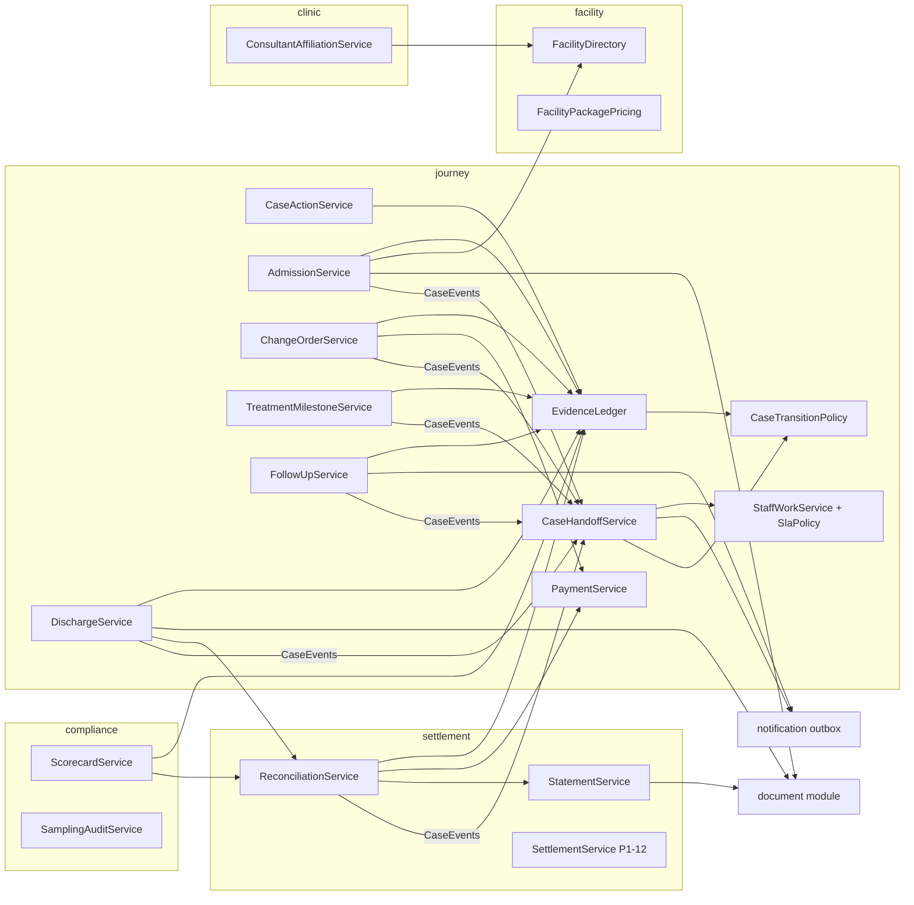

# Solution architecture: the journey after the deposit

**Status:** design for implementation, 2026-10-14. Source requirements: `docs/post-deposit-journey-design.md`
(decisions D-A…D-I pending). Code base: `feat/review-p0` at `69329b8` (schema V94). Plan slots: P1-15…P1-19 in
`docs/platform-review-implementation-plan-2026-10-14.md`.

This document turns the requirements into modules, tables, events, services, endpoints, permissions, work items,
patient states, documents, notifications and tests, following the conventions the code already uses (one transition
map, event-driven handoffs, idempotent work items, append-only money, encrypted free text, ArchUnit layering).

---

## 1. Scope and principles

| In scope | Out of scope (later) |
|---|---|
| Admission reservation and voucher; balance evidence; `ADMISSION_READY`; evidence ledger; milestones; change orders; interim and final invoices; discharge pack; reconciliation; statements; follow-up execution and outcomes; affiliations and scorecards | Platform collection of the hospital package (PSP, DEP-2); hospital e-invoice intake; payer organisations and partners (P1-12 owns them; this design consumes its settlement statement) |

Principles kept from the code:

1. **One transition map.** `CaseTransitionPolicy` gains one state and three edges; nothing else moves a case.
2. **Evidence gates, not clicks.** `entryBlockers(target)` reads the evidence ledger the way it reads readiness today.
3. **Events, then handoffs.** Domain services publish `CaseEvents.*`; `CaseHandoffService` opens work, tells people,
   and attempts the transition; everything idempotent by key.
4. **Money is append-only.** `payment_events` stays the ledger; new rows reference an evidence row.
5. **Free text is encrypted; audit carries codes only.**
6. **Module rule:** `journey → facility`, `coordination → journey`, `journey ↛ coordination`. New code lives in
   `journey.application` (until P1-11 splits `JourneyService`) plus one new module `settlement` for statements and
   payouts, which `journey` depends on; `facility` stays below both.

## 2. Component view



`compliance` is a new thin module (read-only reports) depending on `journey`, `settlement`, `clinic`; nothing depends
on it.

## 3. Lifecycle changes

### 3.1 New state and edges (`CaseTransitionPolicy`)

```
ARRIVAL_CONFIRMED  → ADMISSION_READY        entry blockers: FINAL_QUOTE_ACCEPTED (when a final quote exists),
                                             BALANCE_EVIDENCED, PROCEDURE_CONSENT (or EMERGENCY_OVERRIDE)
ADMISSION_READY    → TREATMENT_IN_PROGRESS  entry blockers: ADMISSION_NUMBER (evidence ADMITTED)
ADMISSION_READY    → CANCELLED              typed reason (CaseExitService; refund class = post point of no return)
TREATMENT_IN_PROGRESS → DISCHARGED          entry blockers: DISCHARGE_PACK_COMPLETE, FINAL_INVOICE (reconciliation may
                                             still be open; an open dispute is recorded, not a blocker)
DISCHARGED → FOLLOW_UP                      unchanged (follow-up plan)
FOLLOW_UP  → CLOSED                         entry blocker: FOLLOW_UP_WINDOW_CLOSED (30 days) or NO_FOLLOW_UP_NEEDED
```

`entryBlockers(target)` returns `BlockerView` rows with codes; `CaseActionService` renders them as the stage checklist
for staff, exactly as readiness blockers today. `ADVANCING` gains `ADMISSION_READY`. `TYPED_CANCELLATION_STAGES`
gains it. `StaffWorkService.stageDefault`: `ADMISSION_READY → HOSPITAL`.

`JourneyService.treatment` requires `ADMISSION_READY | TREATMENT_IN_PROGRESS` (today `ARRIVAL_CONFIRMED | …`) and
calls `EvidenceLedger.require(caseId, BALANCE_EVIDENCED)` in addition to the consent gate. Emergency path: the
existing override pattern, now also covering the balance (`EMERGENCY_ADMISSION_OVERRIDE`, reason, Finance review task).

### 3.2 Migration

`V95__admission_ready_and_evidence.sql` (one logical change per migration file in the series V95–V99):

- `medical_cases.status` CHECK widened with `ADMISSION_READY`; `case_status_history` untouched.
- `case_evidence`, `facility_admissions` (V95); `change_orders`, `change_order_lines` (V96); `statements`,
  `reconciliations`, `reconciliation_lines` (V97); `follow_up_contacts`, `case_outcomes` (V98);
  `consultant_affiliations` (V99). Document type CHECK on `medical_documents.document_type` widened in V95.

## 4. Data model

All tables: `id UUID PK`, `TIMESTAMP WITH TIME ZONE`, one `ADD COLUMN` per `ALTER`, H2-safe, no partial indexes,
fixed UUIDs for seeds.

### 4.1 `case_evidence` (append-only)

| Column | Type | Notes |
|---|---|---|
| case_id | UUID FK medical_cases RESTRICT | |
| stage | VARCHAR(40) | case status when recorded |
| kind | VARCHAR(40) | CHECK list below |
| document_id | UUID FK medical_documents, nullable | must be CLEAN and belong to the case (service check) |
| reference | VARCHAR(160), nullable | admission number, receipt number, provider ref |
| payload | TEXT, nullable, encrypted | structured JSON (milestone details, reconciliation lines) |
| recorded_by | VARCHAR(255) | subject |
| recorded_role | VARCHAR(40) | CONSULTANT / OPERATIONS / FINANCE / COORDINATOR / PATIENT / SYSTEM |
| countersigned_by / countersigned_role / countersigned_at | nullable | required by kind (see §4.1a) |
| supersedes_id | UUID FK case_evidence, nullable | a corrected entry points at the one it replaces |
| recorded_at | TIMESTAMPTZ | |

Indexes: `(case_id, kind)`, `(case_id, recorded_at)`.

Kinds (CHECK): `FACILITY_ADMISSION_LETTER`, `PRICE_VARIANCE_CHECK`, `ARRIVAL_ATTESTED`, `PATIENT_ARRIVED`,
`IDENTITY_SEEN`, `FINAL_QUOTE_ACCEPTED` (derived view, not a row), `BALANCE_EVIDENCED`, `ADMISSION_NUMBER`,
`SURGICAL_PLAN`, `MILESTONE_ADMITTED`, `MILESTONE_PROCEDURE_STARTED`, `MILESTONE_PROCEDURE_COMPLETED`, `MILESTONE_ICU`,
`MILESTONE_WARD`, `MILESTONE_COMPLICATION`, `MILESTONE_STABLE`, `MILESTONE_DISCHARGE_PLANNED`, `INTERIM_BILL`,
`FINAL_INVOICE`, `RECONCILIATION`, `DISCHARGE_SUMMARY`, `MEDICATION_LIST`, `OPERATIVE_NOTE`, `IMPLANT_RECORD`,
`FIT_TO_FLY`, `DEPARTURE_CONFIRMED`, `FOLLOW_UP_DONE`, `OUTCOME_30D`, `OUTCOME_90D`, `HANDOVER_LETTER`,
`EMERGENCY_ADMISSION_OVERRIDE`.

#### 4.1a Countersignature rule (service-enforced, tested)

| Kind | Recorded by | Countersigned by |
|---|---|---|
| `BALANCE_EVIDENCED`, `INTERIM_BILL`, `FINAL_INVOICE` | OPERATIONS | FINANCE (step-up) |
| `RECONCILIATION` | FINANCE | FINANCE_MANAGER when variance > band, else none |
| `MILESTONE_*` recorded by OPERATIONS on the Consultant's behalf | OPERATIONS | CONSULTANT |
| `MILESTONE_*` recorded by CONSULTANT | CONSULTANT | none |
| `FACILITY_ADMISSION_LETTER` | OPERATIONS | FINANCE (`PRICE_VARIANCE_CHECK` row is the countersign) |
| `ARRIVAL_ATTESTED` | OPERATIONS | `PATIENT_ARRIVED` from the patient is the second source (either suffices for the gate; both are kept) |
| `FIT_TO_FLY`, `DISCHARGE_SUMMARY`, `OPERATIVE_NOTE`, `IMPLANT_RECORD`, `MEDICATION_LIST` | CONSULTANT | none |

A gate that needs a countersign is satisfied only by a countersigned row.

### 4.2 `facility_admissions`

| Column | Notes |
|---|---|
| case_id (UNIQUE per open admission), facility_id FK facilities | |
| consultant_id FK practitioner_profiles | |
| proposal_version_id FK proposal_versions | the accepted final quote (or preliminary when none yet) |
| planned_admission_at, admission_week_start | |
| voucher_number VARCHAR(40) UNIQUE | `RS-V-YYYY-NNNNNN`, DB sequence like the case number |
| voucher_document_id | the generated PDF (EN/AR) in the document store |
| package_total_egp, deposit_credit_egp, platform_fee_egp, patient_pays_at_facility_egp, display_currency, fx_rate | frozen when the voucher is issued |
| admission_number VARCHAR(80) | hospital's number, set at ADMITTED |
| status | CHECK `RESERVED / CONFIRMED / ADMITTED / DISCHARGED / CANCELLED` |
| point_of_no_return_at, pnr_set_by, pnr_approved_by | decided rule (Operations sets, Finance approves) |
| created_by/at, updated_by/at, version BIGINT | optimistic lock |

### 4.3 `change_orders` and `change_order_lines`

`change_orders`: case_id, admission_id, treatment_episode_id (nullable), reason (encrypted), status CHECK
`PROPOSED / PRICED / AWAITING_PATIENT / ACCEPTED / REJECTED / EMERGENCY / WITHDRAWN`, total_egp, total_display,
within_band BOOLEAN, proposed_by (consultant), priced_by (finance), decided_by (patient subject or finance),
decided_at, decision_channel (`MY_CARE / ASSISTED`), version.

`change_order_lines`: change_order_id, description, source (`FACILITY_PACKAGE / CATALOG / MANUAL`), facility_package_id
nullable, quantity, unit_egp, line_egp, requires_finance BOOLEAN.

Band rule (`CommercialPolicyService`): new setting `change_order_band_egp` and `change_order_band_rate` on
`commercial_policies` (decision D-E: 10% of the facility package or EGP 15,000, lower wins). `within_band` is computed
at pricing time against the admission's `package_total_egp`.

*As built (P1-16 session 1, 2026-10-15, Flyway V100):* `change_orders` carries `order_number` (`RS-CO-<case>-<n>`), `seq_no`,
`emergency`, `band_limit_egp` (the band at pricing), `display_currency`/`fx_rate`/`total_display` (the voucher's frozen rate),
`decided_role`, `decision_note` (encrypted) and a `decision_channel` of `FINANCE / MY_CARE / SECURE_LINK / CONSULTANT`; there is no
`PRICED` status (pricing ends in `ACCEPTED` within the band or `AWAITING_PATIENT` above it; an emergency stays `EMERGENCY` once
priced). A check constraint makes the band the only path to acceptance (within → Finance, above → the patient). `within_band` is
**cumulative**: the case's counted orders (accepted, emergency) plus this one against the band. Lines carry a `kind` (`PROCEDURE /
IMPLANT / EXTRA_NIGHT / MEDICATION / OTHER`) instead of a `source`; Finance prices every line (no facility-package or catalogue link
yet). `treatment_episode_id` was left out (the episode is not the unit a change is agreed against).

### 4.4 `reconciliations` and `reconciliation_lines` (module `settlement`)

`reconciliations`: case_id, admission_id, final_invoice_evidence_id, invoice_total_egp, quoted_total_egp (final quote
+ accepted change orders), variance_egp, status CHECK `OPEN / CLOSED / DISPUTED`, closed_by, closed_at, note
(encrypted), version.

`reconciliation_lines`: reconciliation_id, invoice_line (text), invoice_egp, matched_source (`PROPOSAL_ITEM /
CHANGE_ORDER_LINE / NONE`), matched_id, variance_code CHECK `WITHIN_BAND / CHANGE_ORDER / UNAPPROVED_EXTRA /
BILLING_ERROR / CREDIT`, variance_egp.

Rule: `UNAPPROVED_EXTRA` is never added to the patient's statement; it opens a `FACILITY_DISPUTE` work item for Finance
and increments the facility's quarterly counter (two → packages suspended pending review: `facilities.status`
stays ACTIVE, `facility_packages` of that facility move to `RETIRED` by Consultant Operations after Compliance
confirms; the automatic part is the Compliance work item, not the retirement).

### 4.5 `statements` (module `settlement`)

case_id, kind CHECK `FINAL_QUOTE / DISCHARGE / CLOSURE / PAYER`, version, document_id (PDF EN/AR), issued_by,
issued_at, totals (package, fee, VAT, deposit credit, change orders, paid, refunded, balance; EGP + display), e_invoice_ref
VARCHAR(80) nullable (the ETA UUID once e-invoicing is integrated), supersedes_id. Immutable; a correction is a new
version.

### 4.6 `follow_up_contacts` and `case_outcomes`

`follow_up_contacts`: follow_up_plan_id, due_at, mode, status CHECK `SCHEDULED / DONE / MISSED / CANCELLED`,
done_by, done_at, note (encrypted), evidence_id. The plan row already holds the first due date; contacts are the
schedule (first at the plan date, then as the Consultant adds).

`case_outcomes`: case_id, point CHECK `D30 / D90`, pain_0_10, function_0_10, satisfaction_0_10, complication BOOLEAN,
complication_note (encrypted), reported_by (patient/representative subject), reported_at, consultant_reviewed_at.
Answered from My Care or a secure link (same OTP flow as the status link; new purpose `OUTCOME`).

### 4.7 `consultant_affiliations` (module `clinic`)

practitioner_id, facility_id, kind CHECK `PRIVILEGES / EMPLOYMENT / FINANCIAL_INTEREST / NONE_DECLARED`, declared_at,
valid_until (yearly), declared_by, reviewed_by (Compliance), reviewed_at, note (encrypted). Unique per
(practitioner, facility, valid_until). `ConsultantEligibilityService` adds: an affiliation declaration not older than
12 months exists (any kind, including `NONE_DECLARED`) — decision D-H.

### 4.8 Existing tables touched

- `deposit_components`: a `PROVIDER` component row is added when the voucher is issued (amount = deposit credit),
  so the settlement to the facility has a ledger line (`payment_events.event_type` gains `SETTLEMENT_RECORDED`).
- `proposal_items.source` gains `PLATFORM_FEE` (decision D-A); `proposal_versions` snapshot gains `platform_fee_egp`,
  `platform_fee_rate`, `vat_rate`; margin columns are kept but the fee is the line the patient sees.
- `medical_documents.document_type` gains the pack kinds and `FACILITY_ADMISSION_LETTER`, `FACILITY_INVOICE`,
  `ADMISSION_VOUCHER`, `STATEMENT`, `HANDOVER_LETTER`.
- `commercial_policies`: `change_order_band_egp`, `change_order_band_rate`, `fit_to_fly_hours` (72),
  `follow_up_free_days` (30).

## 5. Services and flows

### 5.1 `AdmissionService` (journey)

- `reserve(caseId, facilityId, plannedAt)` — OPERATIONS, `OPERATIONS_FULFIL` on CASE_ASSIGNED; case in
  `TRAVEL_COORDINATION`; facility active (`FacilityDirectory.active`); creates `facility_admissions RESERVED`; opens
  Finance work `CHECK_PROFORMA` once the letter is recorded.
- `recordAdmissionLetter(caseId, documentId, quotedEgp, sentBy)` — evidence `FACILITY_ADMISSION_LETTER`; compares
  `quotedEgp` with the package range and the released estimate; outside → `PRICE_VARIANCE` work item (Finance) and
  the travel plan cannot be `CONFIRMED` until `PRICE_VARIANCE_CHECK` is countersigned.
- `issueVoucher(caseId)` — system, on `CaseEvents.FinalQuoteAccepted` (phase 1 also on preliminary acceptance when no
  final quote will exist, flag on the care area): freezes the money split (§4.2), renders the PDF through the
  existing document pipeline (`DocumentService.storeGenerated`), adds the `PROVIDER` deposit component, emails the
  facility contact (`facility-admission-voucher` template) and the patient (`rs_admission_voucher`), evidence none
  (the voucher is a document).
- `recordBalance(caseId, receiptDocumentId, amountEgp, method)` — OPERATIONS records, FINANCE countersigns
  (`EVIDENCE_COUNTERSIGN`, step-up); on countersign publish `CaseEvents.BalanceEvidenced`.
- `recordAdmission(caseId, admissionNumber)` — OPERATIONS or CONSULTANT; evidence `ADMISSION_NUMBER`; publishes
  `CaseEvents.AdmissionRecorded` → handoff attempts `ADMISSION_READY → TREATMENT_IN_PROGRESS`? No: admission is
  recorded by the treatment episode (`JourneyService.treatment`, status `IN_PROGRESS`) which already moves the case;
  the admission number is required input there (`TreatmentRequest.admissionNumber`, mandatory for the first episode).
- `setPointOfNoReturn(caseId, at)` OPERATIONS; `approvePointOfNoReturn` FINANCE (step-up). `CaseExitService` reads it
  for the travel refund class.

### 5.2 `ChangeOrderService` (journey)

```mermaid
sequenceDiagram
  participant C as Consultant
  participant S as ChangeOrderService
  participant F as Finance
  participant P as Patient (My Care)
  participant H as CaseHandoffService
  C->>S: propose(case, reason, lines)
  S->>H: ChangeOrderProposed
  H->>F: work PRICE_CHANGE_ORDER (SLA 4h)
  F->>S: price(order, lines, band check)
  alt within band
    S->>S: status ACCEPTED (Finance alone)
  else above band
    S->>H: ChangeOrderAwaitingPatient
    H->>P: rs_change_order_review (secure link / My Care focus REVIEW_CHANGE_ORDER)
    P->>S: decide(order, ACCEPT|REJECT) step-up PATIENT_DECIDE
  end
  S->>H: ChangeOrderDecided
  H->>C: notify; evidence CHANGE_ORDER row
```

Emergency: `proposeEmergency` (Consultant, reason) → status `EMERGENCY`, priced afterwards, Finance review task,
patient informed; never blocks treatment.

### 5.3 `TreatmentMilestoneService` (journey)

`record(caseId, kind, details, at)` — CONSULTANT (`CLINICAL_REVIEW` on CASE_ASSIGNED) or OPERATIONS on their behalf
(then needs Consultant countersign within 24 h; an uncountersigned milestone shows "reported by the team" to the
patient). `MILESTONE_COMPLICATION` also creates an `incident` (P1-13) of type `ADVERSE_EVENT`. Each milestone
publishes `CaseEvents.MilestoneRecorded` → patient notification (`rs_treatment_update`, calm one-liner, no clinical
detail) and the coordinator's timeline. SLA: `RECORD_MILESTONE` work item opens at admission and after every
milestone with a 24-working-hour due date; it closes when the next milestone arrives.

### 5.4 `DischargeService` (journey)

- `packStatus(caseId)` → required kinds per episode: `DISCHARGE_SUMMARY`, `MEDICATION_LIST`, `OPERATIVE_NOTE` (when a
  procedure milestone exists), `IMPLANT_RECORD` (when the Consultant flagged implants), `FIT_TO_FLY` (when the travel
  plan has a return flight), `FOLLOW_UP_PLAN` (the existing plan row).
- `markDischargeReady` is the existing flag; the transition to `DISCHARGED` is attempted by the handoff on
  `DischargePackComplete` and on `FinalInvoiceRecorded`; blockers from `packStatus` and the invoice.
- Fit-to-fly validity (`fit_to_fly_hours`, D-F): `JourneyService.upsertTravel` refuses `return_confirmed=true` without
  a `FIT_TO_FLY` row whose `recorded_at + hours ≥ flight time`.
- Handover letter: `generateHandoverLetter(caseId)` renders EN/AR from the structured pack (summary, medications,
  follow-up dates, contacts) → document `HANDOVER_LETTER`, evidence row; no free text copied from WhatsApp.

### 5.5 `ReconciliationService` and `StatementService` (settlement)

- `open(caseId, finalInvoiceEvidenceId)` — FINANCE; lines proposed automatically by matching invoice lines to proposal
  items and change-order lines by package id / description similarity (exact id match only is authoritative; the rest
  is a suggestion the officer confirms).
- `close(reconciliationId, lines)` — FINANCE step-up; manager countersign when `variance_egp > band`; writes evidence
  `RECONCILIATION` with the payload; `UNAPPROVED_EXTRA` → dispute path (§4.4); credits → refund via
  `PaymentService.recordRefund`.
- `StatementService.issue(caseId, kind)` — FINANCE; builds totals from the frozen snapshot, `payment_events`, change
  orders and the reconciliation; renders PDF EN/AR; records the platform e-invoice reference when integrated; sends
  `rs_statement_ready` with a secure link (purpose `STATEMENT`, same OTP flow).
- `SettlementService` (P1-12) consumes the admission split and the reconciliation to produce the facility and
  Consultant settlement statement and "mark paid".

*As built (P1-17 session 1, 2026-10-16, Flyway V101):* no PDF renderer is available offline, so statements and the handover letter
are **immutable structured records** the portal renders and prints (open point 1): `statements` holds every total (schema-checked
identities) and the encrypted lines; the handover letter is an encrypted `HANDOVER_LETTER` ledger row with the EN and AR text. The
pack items are typed by their ledger row (`medical_documents` has no type column); fit to fly gates the **return flight**
(`RETURN_CONFIRMED`, D-F), not discharge, and the travel plan's free-text flight field is left alone. The follow-up plan is made before
discharge (the pack's last item); `DISCHARGED -> FOLLOW_UP` (and `-> CLOSED`) waits for the settled reconciliation (`RECONCILIATION`
ledger row, closed or closed with a facility dispute). Reconciliation lines match `PACKAGE` / `CHANGE_ORDER_LINE` / `NONE` (Finance
enters the invoice lines; no automatic description matching yet); `REFUND_CREDIT` is a Finance work item that the existing deposit
refund records, not an automatic `PaymentService.recordRefund`. The facility's quarterly dispute counter and the Compliance item are
not built (P1-19).

### 5.6 `FollowUpService` (journey)

- Scheduling: on `FOLLOW_UP` entry create `follow_up_contacts` from the plan; `FOLLOW_UP_CONTACT` work item per
  contact (due = contact date); reminders to the patient the day before (`rs_follow_up_reminder`).
- Check-ins: coordinator items `CHECK_IN_D3`, `CHECK_IN_D14`, `CHECK_IN_D30` (SlaPolicy calendar days from
  discharge).
- Outcomes: `OUTCOME_30D` / `OUTCOME_90D` requests to the patient (My Care focus `REPORT_OUTCOME` or secure link);
  a reported complication opens an incident and a Consultant item `REVIEW_COMPLICATION` (SLA 4 working hours) and
  offers `REOPEN` (P1-13) from `CLOSED` when already closed.
- Window: `FOLLOW_UP_WINDOW_CLOSED` evidence written by the scheduler at discharge + `follow_up_free_days` when no open
  complication; `CLOSED` attempted by the handoff. Paid teleconsultation after the window is P2-25.

### 5.7 `ConsultantAffiliationService` (clinic) and `compliance`

- `declare(practitionerId, facilityId, kind, note)` CONSULTANT SELF, yearly; `review` COMPLIANCE.
- Case check at `AdmissionService.reserve`: facility without a current declaration by the case's Consultant →
  evidence none, but a `COMPLIANCE_FLAG` work item (`UNDECLARED_FACILITY`) and audit event; the reservation proceeds
  (never block care on paperwork; make it visible).
- `ScorecardService.consultant(id, period)` and `.facility(id, period)`: final-quote-to-preliminary-max ratio,
  change-order rate, unapproved extras, complication rate, reopen rate, pack completeness, follow-up completion,
  outcome averages, patient rating (from the closure review). Read-only, cached 10 min (`CacheNames` entry).
- `SamplingAuditService.sample(month, n)`: picks closed cases, assembles the evidence trail + statement + invoice +
  receipts into one audit record (`audit_samples`), work item for Compliance, findings → incidents.

## 6. Events and handoffs

| Event | Published by | `CaseHandoffService` does |
|---|---|---|
| `AdmissionReserved` | AdmissionService | coordinator notified; patient "Your dates" |
| `AdmissionLetterRecorded` | AdmissionService | Finance `CHECK_PROFORMA` (1 working day) |
| `PriceVarianceRaised` | AdmissionService | Finance `PRICE_VARIANCE` (HIGH); travel confirm blocked |
| `FinalQuoteAccepted` (exists as decision) | JourneyService | `AdmissionService.issueVoucher`; patient focus `PAY_BALANCE` |
| `BalanceEvidenced` | AdmissionService | attempt `ARRIVAL_CONFIRMED → ADMISSION_READY`; patient "cleared"; Finance item closes |
| `ChangeOrderProposed / Priced / AwaitingPatient / Decided` | ChangeOrderService | §5.2 |
| `MilestoneRecorded` | TreatmentMilestoneService | patient line; next `RECORD_MILESTONE` item; incident on complication |
| `InterimBillRecorded` | AdmissionService | Finance countersign item |
| `FinalInvoiceRecorded` | AdmissionService | Finance `RECONCILE_INVOICE` (2 working days); attempt `DISCHARGED` |
| `DischargePackComplete` | DischargeService | attempt `DISCHARGED`; patient "Going home" |
| `ReconciliationClosed` | ReconciliationService | statement `DISCHARGE`; settlement (P1-12); refund if credit |
| `FollowUpContactDue / Done / Missed` | FollowUpService | reminders; coordinator item on missed |
| `OutcomeReported` | FollowUpService | Consultant review on complication; scorecard refresh |
| `FollowUpWindowClosed` | scheduler | statement `CLOSURE`; attempt `CLOSED`; review request |

All handoffs keep the existing idempotency pattern (work item keyed by case + type; outbox keyed by event id).

## 7. API surface (all under `/api/v1`, backend-authorised, step-up where marked)

| Role | Endpoint | Service |
|---|---|---|
| Operations | `POST /operations/cases/{id}/admission` (reserve), `POST …/admission/letter`, `POST …/admission/balance`, `POST …/admission/number`, `POST …/admission/point-of-no-return`, `POST …/admission/bills` (interim/final), `POST …/admission/departure` | AdmissionService |
| Finance | `POST /finance/cases/{id}/evidence/{evidenceId}/countersign` ⚡, `POST /finance/cases/{id}/price-variance/{id}/decide` ⚡, `POST /finance/cases/{id}/change-orders/{id}/price` ⚡, `POST /finance/cases/{id}/reconciliation` / `…/close` ⚡, `POST /finance/cases/{id}/statements/{kind}` ⚡, `POST …/point-of-no-return/approve` ⚡ | Admission, ChangeOrder, Reconciliation, Statement |
| Consultant | `POST /doctor/cases/{id}/change-orders` (+ `/emergency`), `POST /doctor/cases/{id}/milestones`, `POST …/milestones/{id}/countersign`, `POST …/discharge-pack/{kind}` (document or reference), `POST …/fit-to-fly`, `POST …/follow-up-contacts/{id}/done`, `GET /doctor/clinic/affiliations`, `POST …/affiliations` | Milestone, Discharge, FollowUp, Affiliation |
| Coordinator | `GET /coordinator/cases/{id}/evidence` (trail), `POST …/check-ins/{point}/done`, `POST …/admission/voucher/resend` | EvidenceLedger, FollowUp, Admission |
| Patient | `GET /patient/cases/{id}/admission` (voucher view, pay-at-facility instructions), `POST /patient/cases/{id}/arrived`, `POST /patient/cases/{id}/change-orders/{id}/decision` ⚡, `GET /patient/cases/{id}/timeline`, `GET /patient/cases/{id}/documents?kind=pack`, `GET /patient/cases/{id}/statements`, `POST /patient/cases/{id}/outcomes/{point}`; public secure-link equivalents for `OUTCOME` and `STATEMENT` purposes | — |
| Compliance | `GET /compliance/scorecards/consultants/{id}`, `GET /compliance/scorecards/facilities/{id}`, `POST /compliance/audit-samples`, `GET /compliance/cases/{id}/evidence` | compliance |

⚡ = `stepUp` permission. Every write carries an `Idempotency-Key` header where the client may retry (balance,
milestones, decisions), mapped to the evidence `supersedes` / replay semantics.

## 8. Permissions (`Permission`, `RolePolicy`)

| Permission | Step-up | Grants |
|---|---|---|
| `EVIDENCE_RECORD` | no | CONSULTANT, OPERATIONS @ CASE_ASSIGNED; COORDINATOR @ CASE_OWNER (check-ins, arrival); PATIENT/REPRESENTATIVE @ OWN_PATIENT (arrived, outcomes) |
| `EVIDENCE_COUNTERSIGN` | yes | FINANCE @ CASE_DEPOSIT_OPEN ∪ CASE_ASSIGNED (money kinds); CONSULTANT @ CASE_ASSIGNED (clinical kinds) |
| `ADMISSION_MANAGE` | no | OPERATIONS @ CASE_ASSIGNED |
| `CHANGE_ORDER_PROPOSE` | no | CONSULTANT @ CASE_ASSIGNED |
| `CHANGE_ORDER_PRICE` | yes | FINANCE @ PLATFORM |
| `RECONCILE` | yes | FINANCE @ PLATFORM; manager countersign via FINANCE_MANAGER |
| `STATEMENT_ISSUE` | yes | FINANCE @ PLATFORM |
| `PNR_APPROVE` | yes | FINANCE @ PLATFORM |
| `AFFILIATION_DECLARE` | no | CONSULTANT @ SELF |
| `AFFILIATION_REVIEW`, `SCORECARD_READ`, `AUDIT_SAMPLE` | no | COMPLIANCE_AUDITOR (read) ; `AUDIT_SAMPLE` also CARE_COORDINATION_MANAGER? No: Compliance only |
| existing `PATIENT_DECIDE` | yes | change-order decisions |

`CASE_DEPOSIT_READ` (payment view) widens to `CASE_MONEY_OPEN`: Finance sees the payment view while an admission,
change order or reconciliation is open, not only the deposit. System Administrators gain nothing (SOD-07).

## 9. Work items and service levels (`SlaPolicy`)

| Type | Pool / person | Due |
|---|---|---|
| `RESERVE_ADMISSION` | Operations assignee | 3 working days from `TRAVEL_COORDINATION` |
| `CHECK_PROFORMA` | Finance pool | 1 working day |
| `PRICE_VARIANCE` | Finance pool, HIGH | 4 working hours |
| `FINAL_ASSESSMENT` | Consultant | 2 working days from arrival |
| `PAY_BALANCE` (patient action) | patient | reminder days 1–3, coordinator day 4 (reuse `DepositPaymentReminders` shape) |
| `COUNTERSIGN_BALANCE` | Finance pool | 4 working hours |
| `RECORD_MILESTONE` | Consultant | 24 working hours |
| `COUNTERSIGN_MILESTONE` | Consultant | 24 working hours |
| `PRICE_CHANGE_ORDER` | Finance pool | 4 working hours |
| `REVIEW_CHANGE_ORDER` (patient action) | patient | 24 h, then coordinator |
| `DISCHARGE_PACK` | Consultant | before discharge (due = planned discharge) |
| `FIT_TO_FLY` | Consultant | 48 h before the return flight |
| `RECONCILE_INVOICE` | Finance pool | 2 working days |
| `FACILITY_DISPUTE` | Finance Manager | 5 working days |
| `FOLLOW_UP_CONTACT` | Consultant | contact date |
| `CHECK_IN_D3/D14/D30` | Coordinator | calendar days |
| `REVIEW_COMPLICATION` | Consultant, HIGH | 4 working hours |
| `COMPLIANCE_FLAG`, `AUDIT_SAMPLE` | Compliance | 10 working days |

Breach → lead escalation through the existing `raiseWorkDueSoon` and lead alert pattern; Finance Manager escalation
(A-04) is added here for `PRICE_VARIANCE` and `RECONCILE_INVOICE`.

## 10. Patient-facing states (`CaseActionService`)

| Stage | Focus / wait code | Copy intent (EN/AR) |
|---|---|---|
| TRAVEL_COORDINATION | `WAIT_COORDINATION` + new `yourDates` block (admission week, facility, Consultant, what to bring) | "Your dates" |
| ARRIVAL_CONFIRMED | `CONFIRM_ARRIVAL` (focus, until `PATIENT_ARRIVED`/`ARRIVAL_ATTESTED`), then `WAIT_FINAL_QUOTE`, `REVIEW_PROPOSAL` (exists), `PAY_BALANCE` (focus: voucher, where to pay, amount; phase 1 "at the hospital cashier") | Arrival card; final quote; pay to admit |
| ADMISSION_READY | `CLEARED_FOR_ADMISSION` (wait) | "You are cleared for admission on …" |
| TREATMENT_IN_PROGRESS | `IN_TREATMENT` + timeline from milestones; `REVIEW_CHANGE_ORDER` (focus) | plain-language lines, who to call |
| DISCHARGED | `GOING_HOME`: pack documents, statement, follow-up date, 30-day line | "Going home" |
| FOLLOW_UP | `FOLLOW_UP` + contacts; `REPORT_OUTCOME` (focus at D30/D90) | |
| CLOSED | `COMPLETED` + closure review request | |

Representatives see the same through `OWN_PATIENT`. Every money figure in the patient's currency at the frozen
rate and in EGP (`DepositView` pattern).

## 11. Documents, templates, copy

- Generated PDFs (voucher, statements, handover letter): a `DocumentRenderer` port in `document`; implementation with
  the existing HTML-to-PDF path used for proposals if present, else a small server-side renderer; stored through
  `DocumentService.storeGenerated` (CLEAN by construction, audited download).
- Document types added (§4.8); the upload UI gains typed pickers for Operations (bills, letters) and Consultants (pack).
- WhatsApp templates (register with Meta before production): `rs_your_dates`, `rs_arrival_card`,
  `rs_admission_voucher`, `rs_cleared_for_admission`, `rs_treatment_update`, `rs_change_order_review`,
  `rs_discharge_pack_ready`, `rs_statement_ready`, `rs_follow_up_reminder`, `rs_outcome_request`,
  `rs_closure_review`. Each carries a secure link only.
- Copy keys under `myCare.steps.*`, `myCare.timeline.*`, `myCare.money.*`, `portalWork.workCopy.items.*` in `en.json`
  and `ar.json`; Control Center and portal staff screens inline EN/AR as their siblings.

## 12. Security, privacy, audit

- Every service call: `Authority.authorize(permission, Resource.ofCase)`; patient endpoints through ownership; secure
  links through the existing purpose-scoped OTP grant with new purposes `OUTCOME`, `STATEMENT`, `CHANGE_ORDER`.
- Evidence payloads, reasons and notes encrypted (`CryptoService`); audit events carry kind codes, ids and amounts,
  never free text.
- Money: no amount is accepted above the open balance (`AMOUNT_EXCEEDS_BALANCE` pattern); countersign cannot be the
  recorder (`SELF_COUNTERSIGN_REFUSED`); statements immutable.
- Retention (P1-7): evidence and statements are `LEGAL_RECORD` class (long retention, legal hold); outcome answers
  are health data (sensitive, PDPL licence scope).
- Outcome data (P1-18, reviewed for PDPL 2026-10-16): `case_outcomes` scores (0-10) and the complication flag are plain
  columns on pseudonymous rows keyed by case (the schema checks them, P1-19 counts them); every free text (the
  complication, the Consultant's review, contact and check-in notes) is encrypted. Readers: the case's Consultant (all),
  its coordinator and their lead (scores and flags, no free text: `FOLLOW_UP_READ` without `FOLLOW_UP_RECORD`); a reported
  complication is also the adverse-event incident's summary, read by the incident's Care Coordination Manager and
  Compliance (`INCIDENT_READ`). Never Finance or Operations. Each answer stores the purpose notice version it was given
  under and who answered (a representative declares it on the secure link). Messages carry a link only; audit and logs
  carry the point, the channel and ids. Open (owner/legal): the PDPC licence (D-I), the retention class and period for
  outcome and follow-up rows (a health-record class, not `LEGAL_RECORD`; complications inherit the incident's legal
  hold), the breach procedure and DPO; P1-19 reads aggregates only and flags representative answers.
- Logging: `event.code` for every state change; no document names.

## 13. Frontend surfaces

| Surface | Change |
|---|---|
| `MyCare.tsx` | stage blocks per §10; `Timeline` component (milestones); `MoneyLine` (deposit, fee, balance, where to pay); documents filtered by pack; outcomes form |
| `CaseStatusAccess.tsx` | the same blocks for pre-account patients (phases) |
| `StaffCaseView.tsx` | "Admission & money" panel (voucher, letter, balance, change orders, reconciliation link), "Treatment timeline", evidence checklist per stage (from `entryBlockers`) |
| Consultant portal | milestone form (one tap per kind + optional note), change-order form, discharge-pack checklist with typed uploads, fit-to-fly, follow-up contacts, affiliations page in the Virtual Clinic |
| Operations | reservation form, letter upload + quoted amount, balance receipt upload, bills, departure |
| Finance (C2 redesign) | countersign queue, price-variance decision, change-order pricing, reconciliation workbench (two-column invoice vs quote), statements |
| Control Center | Compliance: scorecards, audit samples, affiliation reviews; Finance Manager: bands and windows on Margin & Deposit |

All with CSS logical properties, EN/AR parity, WCAG 2.2 AA, one primary action per screen.

## 14. Tests

- `CaseTransitionPolicyTest`: new state reachable/terminal properties; blockers per edge.
- `AdmissionServiceTest`: reserve/letter/variance/voucher money split (worked example: package 100,000 EGP, fee 15%,
  deposit credit 17,250, patient pays at facility = package − credit), balance countersign refusals, admission number.
  *As built (P1-15 session 1, 2026-10-15):* the money rule follows the design's §6 rule 1 (the deposit covers the platform fee
  first), so the worked example is deposit 17,250 → fee 15,000 covered, credit to the hospital 2,250, patient pays at the hospital
  97,750, fee balance 0; with a capped deposit of 10,000 the hospital is paid 100,000 at its cashier and the platform is owed a fee
  balance of 5,000 (`AdmissionMoneyTest`). The owner confirms this reading (plan, "Owner decisions still open").
- `ChangeOrderServiceTest`: band rule table, patient decision, emergency path, idempotent replay.
- `TreatmentMilestoneServiceTest`: countersign rule, complication → incident, SLA item rotation.
- `DischargeServiceTest`: pack completeness matrix, fit-to-fly window, handover letter render EN/AR.
- `ReconciliationServiceTest`: variance codes, unapproved extra → dispute not statement, credit → refund, manager
  countersign above band.
- `StatementServiceTest`: totals from snapshot + ledger; immutability; supersede.
- `FollowUpServiceTest`: schedule, reminders once, outcomes, window close, reopen on complication.
- `RolePolicyTest`, `PasswordOnlySessionCoverageTest` (new endpoints), `ArchitectureRulesTest` (new modules, no cycles).
- `PostgresJpaMappingTest` with V95–V99.
- Frontend: vitest per component; Playwright `post-deposit-live.spec.ts` building on `operations-gate-live.spec.ts`
  through the tunnel (arrival → voucher → balance → admission → milestones → discharge → follow-up).

## 15. Phase mapping

| Phase | Delivers | Migrations |
|---|---|---|
| P1-10+ | `PLATFORM_FEE` line, snapshot fields, "how your price works", statement `FINAL_QUOTE` (StatementService minimal) | V95a (proposal columns) |
| P1-15 | `case_evidence`, `facility_admissions`, AdmissionService (reserve, letter, variance, voucher, balance, number, PNR), `ADMISSION_READY`, patient `PAY_BALANCE`/`CLEARED`, Operations and Finance screens | V95, V96 |
| P1-16 | milestones, change orders (+band settings), timeline, incidents link (needs P1-13) | V97 |
| P1-17 | discharge pack, fit-to-fly gate, final invoice, reconciliation, statements `DISCHARGE`, departure | V98 |
| P1-18 | follow-up contacts, check-ins, outcomes, window, handover letter, closure review | V99 |
| P1-19 | affiliations, eligibility rule, scorecards, sampling audit, "raise a concern" | V100 |

## 16. Open points for implementation

1. PDF rendering path: confirm what renders proposals today (if HTML only, add a renderer dependency that `mvn -o`
   can resolve from the local repository, or generate HTML documents and let the browser print).
2. `FINAL_QUOTE_ACCEPTED` as a derived blocker vs an evidence row: derived (from `proposal_decisions`) to avoid a
   second source of truth.
3. Phase 1 balance proof is the hospital's cashier receipt; define the minimum fields Operations must enter (receipt
   number, amount, currency, date) so Finance can countersign without the document.
4. Whether the voucher is also issued on a preliminary acknowledgement when the care area never issues final quotes
   (day-case procedures); default: only on the final quote.
